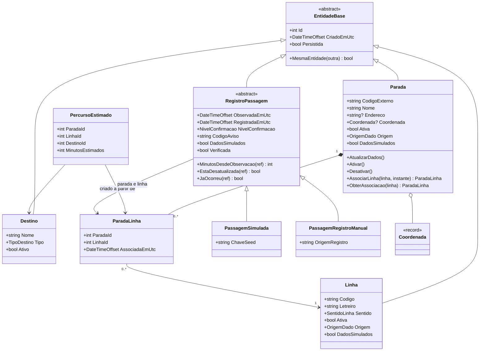

# PontoVoz — Backend C# (ASP.NET Core / .NET 10)

Backend da Global Solution FIAP 2026.2 (CitizenTech) para a disciplina
**C# Software Development**. Visão geral do projeto: [../README.md](../README.md).

## Estágio atual

**Bloco B4 — repositórios, interfaces e consultas LINQ.** Hoje o backend:

- inicia localmente e responde em `GET /health`, que verifica o processo e o banco SQLite
  (200 quando os dois estão saudáveis, 503 quando o banco está indisponível);
- publica o documento OpenAPI e a interface Scalar em Development;
- tem o **modelo de domínio** em `src/PontoVoz.Api/Domain/` (veja [Domínio](#domínio-b2));
- **persiste** o domínio em SQLite com EF Core 10, com migrations e seed idempotente de dados
  fictícios (veja [Persistência](#persistência-b3));
- tem **repositórios com interfaces** e consultas LINQ assíncronas, executadas no SQLite, para os
  futuros endpoints de paradas, linhas, destinos, percursos e últimas passagens, incluindo a busca
  sem acentos (veja [Consultas](#consultas-linq-b4));
- tem **402 testes**: 278 de domínio, 15 de paginação, 106 de integração com SQLite real e 3 do
  `/health` pela API em execução.

Ainda **não** existem services nem endpoints de transporte público. Os endpoints de `/api/v1`
descritos em [`../contracts/api-v1.md`](../contracts/api-v1.md) são **planejados**.

## Requisitos de ambiente

| Item | Versão |
|---|---|
| .NET SDK | 10.0.100 ou superior na linha 10.0 (testado com **10.0.403**) |
| Runtime ASP.NET Core | 10.0.x |
| Sistema | Testado no Windows 11 |
| Editor | Qualquer um (VS Code com C# Dev Kit, Visual Studio 2022+ ou Rider) |

O arquivo [global.json](global.json) exige SDK `10.0.100` com `rollForward: latestFeature`.
Qualquer SDK 10.0.x com feature band igual ou superior é aceito, sem exigir o mesmo patch de todos.

Não é necessário instalar Docker, banco de dados nem ferramentas globais.

## Tecnologias e pacotes

| Pacote | Versão | Uso |
|---|---|---|
| `Microsoft.AspNetCore.OpenApi` | 10.0.14 | Documento OpenAPI nativo |
| `Scalar.AspNetCore` | 2.18.7 | Interface de documentação em `/scalar` |
| `Microsoft.EntityFrameworkCore.Sqlite` | 10.0.14 | EF Core com SQLite: `PontoVozDbContext`, mapeamentos e seed |
| `Microsoft.EntityFrameworkCore.Design` | 10.0.14 | Geração e aplicação das migrations pelo `dotnet ef` |
| `dotnet-ef` (ferramenta **local**) | 10.0.14 | Comandos de migrations, declarado em `.config/dotnet-tools.json` |
| `xunit.v3` | 4.0.2 | Testes automatizados (o projeto de testes é um executável, como exige o xUnit v3) |
| `xunit.runner.visualstudio` e `Microsoft.NET.Test.Sdk` | 4.0.1 e 17.14.1 | Compatibilidade com o Test Explorer das IDEs |
| `Microsoft.Extensions.TimeProvider.Testing` | 10.11.0 | `FakeTimeProvider`, relógio controlado nos testes das regras temporais (só no projeto de testes) |
| `Microsoft.AspNetCore.Mvc.Testing` | 10.0.14 | `WebApplicationFactory`, para testar endpoints pela API real em memória (só no projeto de testes) |

## Executar a partir do GitHub

O repositório **não** contém o banco SQLite: ele é criado na primeira execução, a partir da
migration. Os pré-requisitos são o Git e o .NET SDK 10 (veja
[Requisitos de ambiente](#requisitos-de-ambiente)); Docker e banco de dados instalados não são
necessários. O passo a passo:

```bash
git clone https://github.com/PONTOVOZ-GLOBAL-SOLUTION/pontovoz-csharp.git
```

```bash
cd pontovoz-csharp/backend
```

```bash
dotnet tool restore
```

```bash
dotnet restore
```

```bash
dotnet build
```

```bash
dotnet ef database update --project src/PontoVoz.Api
```

```bash
dotnet run --project src/PontoVoz.Api --launch-profile http
```

Com a API em execução, abra http://localhost:5080/scalar (documentação interativa) e
http://localhost:5080/health. Os testes rodam com `dotnet test`, sem precisar do banco local.
Sem o `dotnet ef database update`, a API inicia, mas o `/health` responde **503**, porque o banco
não existe.

Os dados são **fictícios**: paradas, linhas, destinos, percursos e passagens de demonstração com
o prefixo `SIM-`. Eles não representam a operação real da SPTrans (veja
[Dados de demonstração](#dados-de-demonstração)). No estágio atual, só o `/health` está
disponível como endpoint.

## Como executar

Todos os comandos devem ser executados **dentro da pasta `backend/`**.

```bash
dotnet tool restore
```

```bash
dotnet restore
```

```bash
dotnet build
```

```bash
dotnet test
```

Na primeira vez, crie o banco SQLite aplicando as migrations. O mesmo comando cria os dados de
demonstração (veja [Persistência](#persistência-b3)):

```bash
dotnet ef database update --project src/PontoVoz.Api
```

```bash
dotnet run --project src/PontoVoz.Api --launch-profile http
```

A API fica disponível em `http://localhost:5080` (somente localhost).

### Endereços em Development

| Recurso | Endereço |
|---|---|
| Saúde do processo e do banco | http://localhost:5080/health |
| Documento OpenAPI | http://localhost:5080/openapi/v1.json |
| Interface Scalar | http://localhost:5080/scalar |

Respostas reais de `GET /health`, registradas nas evidências do B3:

```json
{"status":"Healthy","escopo":"processo-e-dependencias","verificadoEm":"2026-11-07T21:47:05.9017706+00:00","verificacoes":[{"nome":"banco-de-dados","status":"Healthy"}]}
```

Com o banco indisponível, a resposta é **503**:

```json
{"status":"Unhealthy","escopo":"processo-e-dependencias","verificadoEm":"2026-11-07T21:48:03.2666865+00:00","verificacoes":[{"nome":"banco-de-dados","status":"Unhealthy"}]}
```

A verificação `banco-de-dados` (`BancoDadosHealthCheck`) confere se o SQLite está acessível e
se todas as migrations foram aplicadas. Ela não cria o banco, não aplica migrations e não expõe
caminhos nem a connection string.

### Testes

O projeto usa xUnit v3 sobre a Microsoft.Testing.Platform, declarada em
`global.json` (`"test": { "runner": "Microsoft.Testing.Platform" }`), como o
.NET 10 SDK exige para essa plataforma.

`dotnet test` executa os testes de domínio (B2), os de integração com SQLite (B3) e os do
`/health` pela API em execução, e termina com código de saída **0** quando todos passam. Os testes de integração usam um banco SQLite
**real** e isolado por teste, em memória ou em arquivo temporário, com o esquema criado pela
migration. Eles não usam o provedor InMemory e não tocam no `pontovoz.db`. Para ver cada teste:

```bash
dotnet test --output detailed
```

Para rodar só os casos J1 a J5 e T1 a T7 da regra temporal do contrato (seção 4.6.3):

```bash
dotnet test --filter-method "*CasosDoContrato"
```

Para rodar só os testes de integração:

```bash
dotnet test --filter-namespace "PontoVoz.Tests.Infrastructure"
```

As evidências estão em [Domínio](#evidências-dos-testes) e em
[`docs/evidencias/B3-persistencia.md`](docs/evidencias/B3-persistencia.md).

### HTTPS (opcional)

O perfil `https` usa `https://localhost:7080` e `http://localhost:5080`:

```bash
dotnet run --project src/PontoVoz.Api --launch-profile https
```

Para o navegador não mostrar aviso de segurança, o certificado de desenvolvimento
precisa ser marcado como confiável. Esse comando altera o repositório de certificados
do Windows, então execute-o só se quiser:

```bash
dotnet dev-certs https --trust
```

Em Development a API não redireciona HTTP para HTTPS, para que a equipe possa
usar a porta 5080 mesmo sem o certificado confiável. Fora de Development o
redirecionamento fica ativo.

### Ferramenta do EF Core

```bash
dotnet ef --version
```

Deve mostrar `10.0.14`. Comandos úteis:

```bash
dotnet ef migrations list --project src/PontoVoz.Api
```

```bash
dotnet ef migrations has-pending-model-changes --project src/PontoVoz.Api
```

## Estrutura

```
backend/
├─ PontoVoz.slnx                 solução (formato .slnx do .NET 10)
├─ global.json                   versão mínima do SDK e plataforma de testes
├─ .config/dotnet-tools.json     ferramenta local dotnet-ef
├─ .editorconfig                 padrão de estilo do código
├─ docs/evidencias/              evidências de funcionamento por bloco
├─ src/PontoVoz.Api/
│  ├─ Program.cs                 composição da aplicação e injeção de dependência
│  ├─ Controllers/               controllers REST (hoje só HealthController)
│  ├─ Domain/                    modelo de domínio (B2)
│  │  ├─ Entities/               entidades persistentes e associações
│  │  ├─ ValueObjects/           objetos de valor imutáveis
│  │  ├─ Enums/                  enums do contrato v1
│  │  ├─ Exceptions/             exceções de domínio com o código de erro do contrato
│  │  └─ Rules/                  regras compartilhadas (temporal e de cadastro)
│  ├─ Application/               interfaces de acesso a dados e tipos de consulta (B4); services e DTOs (B5)
│  │  ├─ Consultas/              Paginacao e Pagina<T>
│  │  └─ Interfaces/             interfaces dos repositórios
│  ├─ Infrastructure/            EF Core, repositórios e provedores (B3, B4, B8)
│  │  ├─ Persistence/            DbContext, mapeamentos, conversor UTC, busca, migrations e seed (B3, B4)
│  │  └─ Repositories/           implementações das interfaces com EF Core e LINQ (B4)
│  ├─ Security/                  proteção das rotas administrativas (B7)
│  └─ Middleware/                tratamento global de erros (B6)
└─ tests/PontoVoz.Tests/         testes xUnit (referencia o projeto da API)
   ├─ Domain/                    testes de domínio (B2)
   └─ Infrastructure/            testes de integração com SQLite real (B3)
```

## Domínio (B2)

O domínio fica em `src/PontoVoz.Api/Domain/` e não depende de ASP.NET Core nem de EF Core.
Ele segue o contrato [`../contracts/api-v1.md`](../contracts/api-v1.md) (versão B1.3).

### Entidades e relacionamentos



| Tipo | Papel |
|---|---|
| `Parada` | Ponto de ônibus. Raiz das associações com linhas. |
| `Linha` | Linha em um sentido. Cada sentido é um cadastro próprio. |
| `ParadaLinha` | Associação N:N entre parada e linha, com o instante da associação |
| `Destino` | Destino consultável pelo totem. Só do seed no MVP. |
| `PercursoEstimado` | Minutos de uma linha, a partir de uma parada que ela atende, até um destino |
| `RegistroPassagem` (abstrata) | Passagem histórica de uma linha pela parada |
| `PassagemSimulada` | Observação de demonstração do provisionamento inicial, com `ChaveSeed` |
| `PassagemRegistroManual` | Observação informada por um operador, com `OrigemRegistro` |
| `Coordenada`, `ReferenciaLinha` | Objetos de valor imutáveis, comparados por valor |
| `PrevisaoChegada`, `ResultadoProvedor` | Previsão de chegada e resultado do provedor. Nunca são passagens. |
| `AlternativaDeslocamento` | Resultado calculado (espera + percurso). Não é persistido. |
| `RegraTemporalPassagem` | Regra da seção 4.6.3 do contrato, compartilhada por entidades e futuros services |

### Invariantes

- **Formatos:** as expressões regulares usam `\A` e `\z`, que exigem a entrada inteira. Com `^`
  e `$`, o .NET aceitaria um valor seguido de quebra de linha. Os formatos são
  `\A[A-Z0-9-]{3,30}\z` para códigos, `\A[A-Za-z0-9-]{1,20}\z` para prefixo de veículo,
  `\A[a-z0-9-]{3,40}\z` para `origemRegistro` e `\ASIM-[A-Z0-9-]{3,36}\z` para `ChaveSeed`.
- **Prefixo `SIM-` em códigos e letreiros:** depende da origem. É obrigatório na origem
  `Simulado` e proibido nos cadastros administrativos, inclusive nos fictícios, que usam outro
  prefixo, como `TESTE-`.
- **Prefixo `SIM-` em veículos:** depende da natureza do registro, não da origem. Um registro
  fictício (parada ou linha fictícia) identifica o veículo com `SIM-`. Um registro com dados
  reais não pode usar `SIM-`. O prefixo continua opcional.
- **Textos:** nome de 3 a 120 caracteres (sem os espaços das pontas), letreiro de 1 a 30,
  terminais de 3 a 120, endereço até 200 (vazio vira `null`).
- **Coordenada:** latitude de -90 a 90 e longitude de -180 a 180, sem `NaN`.
- **Natureza do dado:** a origem `Simulado` sempre tem `DadosSimulados = true`. Num cadastro
  administrativo, o operador declara a natureza, e o domínio não presume nenhum dos dois
  valores. Código, origem e `DadosSimulados` não mudam depois da criação. Uma parada fictícia
  não tem endereço nem coordenada.
- **Associações:** sem duplicidade, porque `AssociarLinha` é idempotente como o `PUT` do
  contrato. Parada inativa recusa com `ParadaInativa` e linha inativa com `LinhaInativa`.
- **Percurso:** de 1 a 240 minutos e criado a partir de uma `ParadaLinha`. Por isso não existe
  percurso de uma linha que não atende a parada.
- **Passagens:** horários definidos na criação, sem método que os altere. O registro manual
  aceita `observadaEm` de 24 horas antes a 2 minutos depois do instante do registro e exige
  `origemRegistro` no formato técnico, além de parada e linha ativas e associadas.
  Nenhum registro é verificado nem oficial.
- **Regra temporal:** minutos inteiros arredondados para baixo e nunca negativos. A passagem
  fica desatualizada quando o intervalo exato passa de 60 minutos. Um registro com horário
  futuro ainda não conta como passagem ocorrida (`JaOcorreu`).
- **Previsões vencidas:** `PrevisaoChegada.VencidaEm` indica um horário previsto anterior à
  referência. `ResultadoProvedor.Respondido` descarta essas previsões antes de calcular o status
  (só vencidas resulta em `SemPrevisoes`). `AlternativaDeslocamento.Calcular` trata uma previsão
  vencida como ausente (`SemPrevisao`). Uma previsão exatamente no instante da consulta é válida,
  com espera 0.
- **Erros:** `ValidacaoDominioException` corresponde a 400 `RequisicaoInvalida`, com o campo do
  contrato, e `RegraNegocioException` corresponde a 422, com o código do contrato.

### Conceitos de POO

| Conceito | Onde |
|---|---|
| Encapsulamento | Todas as propriedades das entidades têm `private set`. O estado muda só por métodos que preservam as invariantes (`Parada.AtualizarDados`, `AssociarLinha`, `Ativar`/`Desativar`). A coleção de linhas é exposta como somente leitura. |
| Abstração | `EntidadeBase` e `RegistroPassagem` são abstratas. `DominioException` abstrai as exceções que o B6 converte em ProblemDetails. |
| Herança | `Parada`, `Linha`, `Destino` e `RegistroPassagem` herdam de `EntidadeBase`. `PassagemSimulada` e `PassagemRegistroManual` herdam de `RegistroPassagem`. |
| Polimorfismo | `NivelConfirmacao`, `CodigoAviso`, `DadosSimulados` e `OrigemRegistro` são sobrescritos em cada tipo de passagem. `Verificada` e os cálculos temporais são herdados e funcionam igual para qualquer `RegistroPassagem`. |
| Composição | `Parada` compõe `ParadaLinha` e `Coordenada`. `PercursoEstimado` e `RegistroPassagem` são criados a partir de uma `ParadaLinha`. `PrevisaoChegada` e `AlternativaDeslocamento` compõem `ReferenciaLinha`. |
| Métodos de fábrica | `CriarSimulada`, `CadastrarAdministrativa`, `CriarNoProvisionamento` e `Registrar` deixam explícitas a origem e a natureza de cada dado. Não há construtor público. |
| Responsabilidade única | As regras temporais ficam em `RegraTemporalPassagem`, e as validações de cadastro em `RegrasCadastro`. As entidades as usam sem duplicá-las. |

Interfaces de repositório e de serviço entram nos blocos em que suas operações forem
implementadas (B4, B5 e B8).

### Evidências dos testes

Execução de `dotnet test` em 07/11/2026, depois de `dotnet restore` e `dotnet build`
(0 avisos, 0 erros):

```
Resumo da execução de teste: Aprovado!
  total: 278
  falhou: 0
  concluído com êxito: 278
  ignorados: 0
```

Código de saída: 0.

| Classe de teste | Testes | Cobre |
|---|---|---|
| `ParadaTests` | 44 | Código, nome, endereço, natureza do dado, atualização, ativação, associações |
| `LinhaTests` | 38 | Código, letreiro, prefixo `SIM-`, terminais, sentido, encapsulamento e construtores para o EF Core |
| `RegistroPassagemTests` | 40 | Polimorfismo, passagem simulada, registro manual, J1 a J5 na entidade, horário futuro, 422 |
| `RegraTemporalPassagemTests` | 32 | J1 a J5, T1 a T7 e valores intermediários e extremos |
| `PrevisaoEAlternativaTests` | 20 | Previsão, resultado do provedor e cálculo da alternativa |
| `DestinoEPercursoTests` | 14 | Destino e percurso de 1 a 240 minutos |
| `CoordenadaTests` | 12 | Limites e igualdade por valor |
| `FormatoEntradaTests` | 34 | Quebra de linha no início, no meio e no fim e caracteres fora do formato em códigos, veículo, `origemRegistro` e `ChaveSeed` |
| `PrefixoVeiculoTests` | 25 | Veículo `SIM-` em registros fictícios (do seed ou administrativos) e proibido em registros reais |
| `PrevisaoVencidaTests` | 19 | Previsões vencidas, no instante exato e futuras; resultados só vencidos e mistos; alternativa com previsão vencida |

Os testes também foram conferidos ao contrário, com mutações temporárias do código, depois
restaurado:

| Mutação | Testes que falham |
|---|---|
| `>` trocado por `>=` na desatualização e na tolerância de 2 minutos | 3 (T5 e J2) |
| `\A...\z` trocado por `^...$` | 5 (um por campo com quebra de linha final) |
| Sem o descarte de vencidas em `Respondido` | 3 |
| Sem a proteção de `AlternativaDeslocamento.Calcular` | 4 |
| Prefixo de veículo do registro manual só por formato | 11 |

## Persistência (B3)

A persistência fica em `src/PontoVoz.Api/Infrastructure/Persistence/`. O domínio não depende
dela.

| Arquivo | Papel |
|---|---|
| `PontoVozDbContext.cs` | `DbSet` de cada entidade e convenções comuns (instantes e enums) |
| `Configuracoes/` | Um mapeamento Fluent API por entidade (`IEntityTypeConfiguration`) |
| `Conversores/InstanteUtcParaTicksConverter.cs` | Conversão de `DateTimeOffset` para ticks UTC |
| `Seed/DadosDemonstracao.cs` | Monta os dados fictícios com as fábricas do domínio |
| `Seed/ProvisionamentoDemonstracao.cs` | Decide se o seed roda e o grava, nos fluxos síncrono e assíncrono |
| `PersistenciaExtensions.cs` | Registro do contexto na injeção de dependência e configuração do SQLite |
| `Migrations/` | Migration `InitialCreate` e o snapshot do modelo |

### Configuração do SQLite

A connection string fica em `appsettings.json` (`ConnectionStrings:PontoVoz`), sem credenciais:

```json
"ConnectionStrings": { "PontoVoz": "Data Source=pontovoz.db" }
```

Um caminho relativo é resolvido a partir da pasta do projeto, então a API e o `dotnet ef` usam
o mesmo arquivo, `src/PontoVoz.Api/pontovoz.db`. Esse arquivo é **local** e é ignorado pelo Git
(`*.db` no `.gitignore`). O `PontoVozDbContext` é registrado com
`builder.Services.AddPersistenciaPontoVoz(...)` no `Program.cs`, com tempo de vida *scoped*, o
padrão do `AddDbContext`.

### Criar o banco, aplicar a migration e o seed

```bash
dotnet ef database update --project src/PontoVoz.Api
```

O comando aplica as migrations pendentes e, em seguida, roda duas etapas pelo gancho
`UseSeeding` do EF Core: o preenchimento da coluna de busca dos registros antigos (B4) e o seed
de demonstração. O `Database.MigrateAsync` usa as mesmas etapas pelo gancho `UseAsyncSeeding`,
que os testes exercitam. A API **não** aplica migrations ao iniciar, e nenhuma etapa roda por
requisição HTTP. Repetir o comando não muda um banco já atualizado.

Num banco criado no B3, o mesmo comando aplica a migration `AddSearchColumns` do B4 sem apagar
nem alterar os dados existentes.

### Tabelas e relações

| Tabela | Chave | Relações e restrições |
|---|---|---|
| `Paradas` | `Id` | `CodigoExterno` único; `Latitude` e `Longitude` anuláveis (objeto de valor `Coordenada`) |
| `Linhas` | `Id` | `Codigo` único |
| `ParadasLinhas` | (`ParadaId`, `LinhaId`) | FK para `Paradas` e `Linhas` |
| `Destinos` | `Id` | `Nome` único (chave natural usada pelo seed; o contrato não tem código de destino) |
| `PercursosEstimados` | (`ParadaId`, `LinhaId`, `DestinoId`) | FK composta para `ParadasLinhas` (a linha precisa atender a parada) e FK para `Destinos`; `CHECK` de 1 a 240 minutos |
| `RegistrosPassagem` | `Id` | Hierarquia TPH com `TipoPassagem` (`Simulada` ou `RegistroManual`); FK composta para `ParadasLinhas`; `ChaveSeed` única quando não nula; índice (`ParadaId`, `LinhaId`, `ObservadaEmUtc`) para a consulta da última passagem |

- **Exclusões:** todas as chaves estrangeiras usam `RESTRICT`. Nenhuma exclusão apaga passagens
  históricas em cascata, porque os cadastros são desativados, não excluídos.
- **TPH:** a subclasse correta é reconstruída ao ler do banco. `NivelConfirmacao`,
  `CodigoAviso`, `Verificada` e `OficialSptrans` são calculados pelo tipo e não viram colunas.
- **Registro manual:** `OrigemRegistro` e `DadosSimulados` são gravados a partir dos campos
  privados da classe. Nas passagens simuladas essas colunas ficam nulas, e `DadosSimulados` é
  sempre `true` pelo próprio tipo.

### Instantes em UTC

Todo `DateTimeOffset` é gravado como **ticks UTC** (`INTEGER`), por
`InstanteUtcParaTicksConverter`. Motivos:

- o provedor SQLite do EF Core não traduz `ORDER BY` nem comparações sobre `DateTimeOffset`.
  Com inteiros, a ordenação e o filtro `ObservadaEmUtc <= @referencia` rodam no banco;
- a precisão de 100 ns é preservada, o que importa para a regra temporal do domínio, que
  compara o intervalo exato;
- a leitura devolve sempre deslocamento zero.

A API pública do domínio não mudou: as entidades continuam com `DateTimeOffset`.

### Dados de demonstração

No **primeiro provisionamento** de um banco vazio, o seed cria 21 registros coerentes com
`contracts/exemplos/`: 2 paradas, 4 linhas, 5 associações, 3 destinos, 5 percursos e 2 passagens
simuladas.

- **Identificação:** todos os registros têm origem `Simulado`, `DadosSimulados = true` e códigos
  com `SIM-`. As passagens simuladas têm `ChaveSeed` (`SIM-OBS-001` e `SIM-OBS-002`) e nunca são
  verificadas nem oficiais.
- **Horários:** são calculados uma única vez, 15 e 25 minutos antes do instante do
  provisionamento, lido do `TimeProvider`.
- **Banco já provisionado** (existe uma parada do seed): o seed não faz nada. Não duplica, não
  renova horários, não cria passagens e não toca nos registros manuais.
- **Passagem recente na demonstração:** vem do registro manual administrativo (B7), conforme a
  seção 4.6.2 do contrato.
- **Ids internos:** são gerados pelo banco e **não são estáveis** entre bancos diferentes, como
  diz a seção 1.2 do contrato. Os dados de demonstração são identificados pelos códigos (`SIM-P001`,
  `SIM-L004`...) e, nos destinos, pelo nome. Os ids dos exemplos JSON do contrato são ilustrativos.
  Nenhuma consulta, teste funcional ou regra depende de um id específico nem da ordem de inserção
  do seed. O teste `Provisionamento_ComIdsDiferentesDosExemplos_RelacionaTudoPeloCodigo` confirma
  que tudo continua correto quando os ids são outros.

### O que funciona e o que está planejado

| Funciona (B3) | Planejado |
|---|---|
| Esquema SQLite criado pela migration | Services e DTOs (B5) |
| Persistência e leitura de todas as entidades | Endpoints REST (B6 e B7) |
| Seed idempotente nos fluxos síncrono e assíncrono | |
| Ordenação e filtro por instante no SQL | |
| Verificação do banco no `/health` (200 ou 503) | |

Os repositórios e a busca sem acentos, previstos aqui para o B4, estão em
[Consultas](#consultas-linq-b4).

### Orientações registradas no B3

- **`DadosSimulados` das passagens:** a coluna `DadosSimulados` de `RegistrosPassagem` existe
  só para o registro manual e fica `NULL` nas passagens simuladas, que são fictícias pelo próprio
  tipo (`TipoPassagem = 'Simulada'`). Essa é uma decisão de armazenamento válida: o objeto lido
  do banco sempre informa `DadosSimulados` corretamente, e um filtro pela propriedade calculada
  (`Where(p => p.DadosSimulados)`) **não é traduzido**: o EF Core lança exceção, em vez de filtrar
  errado. Se o B4 precisar filtrar no SQL, deve usar a forma testada em
  `AuditoriaPersistenciaTests`:

  ```csharp
  passagens.Where(p => p is PassagemSimulada
      || (p is PassagemRegistroManual && EF.Property<bool>((PassagemRegistroManual)p, "_dadosSimulados")))
  ```

- **Busca sem acentos (R7):** o `LIKE` do SQLite ignora maiúsculas só em ASCII e não ignora
  acentos. O teste `BuscaComLikeDoSqlite_NaoIgnoraAcentos...` confirma: `%demonstracao%` não
  encontra "Demonstração", e `%DEMONSTRAÇÃO%` também não. O plano do B3 previa colunas por campo e
  indexadas. No B4, a implementação usa uma coluna por tabela e nenhum índice, pelos motivos
  descritos em [Busca sem acentos](#busca-sem-acentos-r7).
- **Unicidade de `Destinos.Nome`:** é coerente com o contrato. O destino não tem código próprio
  (seção 3.5), o MVP só tem destinos do seed e um nome repetido deixaria ambígua a escolha que a
  IA pede à pessoa (seção 4.4).

## Consultas LINQ (B4)

As consultas que os futuros services e endpoints vão usar ficam atrás de interfaces em
`Application/Interfaces/`, implementadas com EF Core e LINQ em `Infrastructure/Repositories/`.
Elas devolvem entidades do domínio ou `Pagina<T>`, nunca `IQueryable`, e são registradas na
injeção de dependência como *scoped*, junto com o `PontoVozDbContext`
(`AddPersistenciaPontoVoz`). Um service do B5 recebe, por exemplo, `IParadaRepository` pelo
construtor.

| Interface | Métodos | Uso no contrato |
|---|---|---|
| `IParadaRepository` | `BuscarAtivasAsync(termo, codigoExterno, paginacao)` · `ObterAtivaAsync(id)` | `GET /paradas`, `GET /paradas/{id}` e o cabeçalho das respostas da parada |
| `ILinhaRepository` | `BuscarAtivasAsync(termo, paginacao)` · `ObterAtivaAsync(id)` · `ListarAtivasDaParadaAsync(paradaId)` · `AtendeParadaAsync(paradaId, linhaId)` | `GET /linhas`, linhas da parada, 404 de linha e 422 `LinhaNaoAtendeParada` |
| `IDestinoRepository` | `BuscarAtivosAsync(termo, paginacao)` · `ObterAtivoAsync(id)` · `ListarPercursosDiretosAsync(paradaId, destinoId)` | `GET /destinos`, 404 de destino e os dados de entrada das alternativas (B9) |
| `IRegistroPassagemRepository` | `ListarUltimasPorLinhaAsync(paradaId, referencia, linhaId)` | `GET /paradas/{id}/ultimas-passagens` e o resumo |

As associações entre paradas e linhas ficam em `ILinhaRepository`, e os percursos, em
`IDestinoRepository`. Não há repositório genérico.

### Regras aplicadas nas consultas

- **Cadastros ativos:** todas as consultas públicas filtram `Ativa` ou `Ativo` (divergência D10
  do contrato). Linhas inativas saem da lista da parada, dos percursos e das últimas passagens,
  sem apagar o histórico.
- **Associação persistida:** "linha que atende a parada" é sempre uma linha em `ParadasLinhas`.
  As consultas partem dessa tabela, e não da existência separada da parada e da linha.
- **Ordenação fixa com desempate:** paradas e destinos por `nome` e `id`; linhas por `codigo` e
  `id`; percursos por minutos e código da linha; passagens do mais recente para o mais antigo e,
  depois, pelo código da linha.
- **Paginação no banco:** `COUNT(*)`, depois `ORDER BY ... LIMIT ... OFFSET`. `Paginacao` aceita
  página ≥ 1 e tamanho de 1 a 50 (padrão 20). `Pagina<T>` calcula `totalPaginas` como no contrato:
  0 quando não há itens, e uma página além do total devolve `itens` vazio.
- **Somente leitura:** todas as consultas usam `AsNoTracking`.
- **`CancellationToken`:** todos os métodos recebem e repassam o token ao EF Core. Um token
  cancelado interrompe a consulta, como mostra um dos testes.

Exemplo real, a busca de paradas (`ParadaRepository`):

```csharp
IQueryable<Parada> consulta = contexto.Paradas
    .AsNoTracking()
    .Where(parada => parada.Ativa)
    .ContendoTexto(termo);                       // LIKE na coluna normalizada

if (!string.IsNullOrWhiteSpace(codigoExterno))
{
    string codigo = codigoExterno.Trim().ToUpperInvariant();
    consulta = consulta.Where(parada => parada.CodigoExterno == codigo);
}

return await consulta
    .OrderBy(parada => parada.Nome)
    .ThenBy(parada => parada.Id)
    .PaginarAsync(paginacao, cancellationToken);  // CountAsync + Skip/Take + ToListAsync
```

O SQL que o EF Core gera para cada método está em
[`docs/evidencias/B4-consultas-linq.md`](docs/evidencias/B4-consultas-linq.md).

### Busca sem acentos (R7)

`termo` encontra "Demonstração" escrito como `demonstracao`, `DEMONSTRAÇÃO`, com espaços a mais
ou com acentos combinados (letra + sinal Unicode separado). Funcionamento:

1. **Normalização (`TextoBusca.Normalizar`):** decomposição Unicode (FormD), remoção dos sinais
   diacríticos, minúsculas e espaços reduzidos a um só. A mesma função é usada na gravação e no
   termo da consulta, então as duas comparam o mesmo formato.
2. **Coluna `TextoBusca`:** uma por tabela pesquisável. `Paradas` guarda nome e código, `Linhas`
   guarda código, letreiro e os dois terminais, e `Destinos` guarda o nome. Os campos são separados
   por quebra de linha. Como o termo normalizado nunca contém quebra de linha, uma busca não
   atravessa dois campos. É uma propriedade sombra do EF Core: o domínio não muda, e os campos
   exibidos (`Nome`, `Letreiro`...) continuam com o texto original.
3. **Atualização:** o `PontoVozDbContext` recalcula a coluna de toda parada, linha ou destino
   adicionado ou alterado, no `SaveChanges` e no `SaveChangesAsync`. Uma parada renomeada passa a
   ser encontrada pelo nome novo, e não pelo antigo.
4. **Consulta:** `LIKE @padrao ESCAPE '\'` sobre a coluna, no SQL. `%`, `_` e `\` do termo são
   escapados, e por isso `100%` procura o texto "100%" literalmente.
5. **Registros antigos:** a migration `AddSearchColumns` cria a coluna com valor vazio. Depois das
   migrations, a etapa `PreenchimentoTextoBusca` preenche as linhas vazias com a mesma
   normalização. A etapa é idempotente: num banco já preenchido, não grava nada. O SQL da
   migration não conseguiria reproduzir a normalização Unicode do .NET, por isso ela roda em C#.

**Sem índice para `TextoBusca`:** um `LIKE '%termo%'` começa com curinga e não usa índice.
`EXPLAIN QUERY PLAN` confirma `SCAN Paradas`. Com o volume do MVP, a varredura é adequada. A
busca exata por `codigoExterno` usa o índice único (`SEARCH ... USING INDEX
IX_Paradas_CodigoExterno`).

**Limitação:** quem aplicar as migrations por um script SQL gerado (`dotnet ef migrations
script`), fora do EF Core, precisa rodar a API ou o `dotnet ef database update` uma vez para que
a etapa de preenchimento aconteça.

### Última passagem por linha

`ListarUltimasPorLinhaAsync` escolhe, no SQL, uma passagem por linha ativa da parada:

```csharp
IQueryable<int> idsDasUltimas = candidatas          // parada, ObservadaEmUtc <= referencia, linha ativa
    .GroupBy(passagem => passagem.LinhaId)
    .Select(grupo => grupo
        .OrderByDescending(passagem => passagem.ObservadaEmUtc)
        .ThenByDescending(passagem => passagem.RegistradaEmUtc)
        .ThenByDescending(passagem => passagem.Id)
        .Select(passagem => passagem.Id)
        .First());

return await contexto.RegistrosPassagem
    .AsNoTracking()
    .Include(passagem => passagem.Linha)
    .Where(passagem => idsDasUltimas.Contains(passagem.Id))
    .OrderByDescending(passagem => passagem.ObservadaEmUtc)
    .ThenBy(passagem => passagem.Linha.Codigo)
    .ToListAsync(cancellationToken);
```

- **SQL:** o EF Core traduz para um único comando, com `GROUP BY "LinhaId"` e uma subconsulta
  `ORDER BY ObservadaEmUtc DESC, RegistradaEmUtc DESC, Id DESC LIMIT 1` por grupo. Nenhum registro
  é agrupado em memória.
- **Horário futuro:** um registro manual ainda no futuro (tolerância de 2 minutos) fica de fora
  até o horário chegar.
- **Desempate:** é o da seção 4.6.1 do contrato.
- **Tipo concreto:** cada item volta como `PassagemSimulada` ou `PassagemRegistroManual`, com
  `DadosSimulados`, nível de confirmação e aviso corretos. Nenhum é verificado.
- **O que fica com o B5:** os minutos desde a observação, a marcação de desatualizada, os avisos e
  a lista `linhasSemRegistro`, montada a partir de `ListarAtivasDaParadaAsync`.

### Executar os testes das consultas

```bash
dotnet test --filter-namespace "PontoVoz.Tests.Infrastructure"
```

| Classe | Testes | Cobre |
|---|---|---|
| `TextoBuscaTests` | 19 | Normalização, acentos combinados, espaços, curingas do `LIKE` |
| `RepositoriosConsultaTests` | 34 | Paradas, linhas, associações, destinos, percursos, inativos, paginação no SQL e cancelamento |
| `PaginacaoTests` (namespace `PontoVoz.Tests.Application`, fora do filtro acima) | 15 | Valores padrão (nunca tamanho 0), faixas aceitas e recusadas, `totalPaginas` |
| `UltimasPassagensTests` | 9 | Última por linha, desempates, horário futuro, filtro por linha, tipos e natureza, SQL em um comando |
| `MigracaoBuscaTests` | 4 | `AddSearchColumns` em banco com dados do B3, reaplicação, renomeação e curingas |

### Implementado e pendente

| Implementado (B4) | Pendente |
|---|---|
| 4 interfaces de repositório e suas implementações com EF Core e LINQ | Services, DTOs e validação de parâmetros com 400 (B5) |
| Busca sem acentos com coluna normalizada e migration `AddSearchColumns` | Endpoints REST (B6 e B7) |
| Paginação, ordenação e filtros executados no SQLite | Provedores de previsão (B8) |
| Última passagem por linha no SQL | Cálculo das alternativas e resumo (B9) |
| Registro na injeção de dependência | |

## Próximas etapas

| Bloco | Conteúdo |
|---|---|
| B1 | Contrato v1 em `../contracts/` (concluído) |
| B2 | Entidades e regras de domínio, com testes (concluído) |
| B3 | `DbContext`, migration inicial e seed de dados simulados (concluído) |
| B4 | Repositórios com consultas LINQ, com testes (concluído, aguardando revisão) |
| B5 | Services, DTOs e injeção de dependência, com testes |
| B6 | Endpoints públicos, tratamento de erros e exportação do contrato OpenAPI |
| B7 | Endpoints administrativos com chave de acesso |
| B8 | Provedores de previsão (simulado e adaptador HTTP Olho Vivo) |
| B9 | Alternativas de deslocamento e resumo da parada |
| B10 | Documentação final, evidências e entrega |
