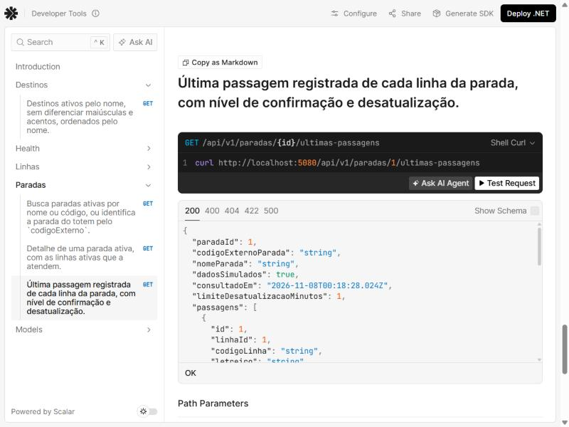
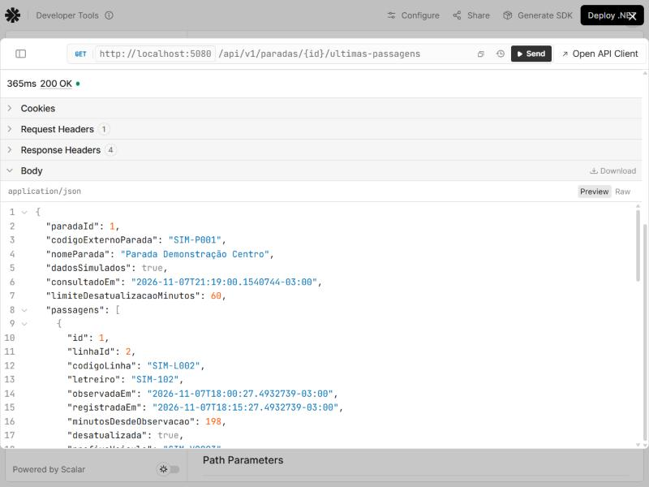

# Evidências — Bloco B6 (Web API pública, ProblemDetails, OpenAPI e testes HTTP)

O B6.1 (auditoria final) mudou um comportamento: o 404 de rota sem correspondência e o 405
passaram a ter `codigo`. As respostas da seção [B6.1](#b61--auditoria-final) substituem as do B6
para esses casos; as demais seções continuam válidas.

Data da execução: 07/11/2026, no Windows 11, com o .NET SDK 10.0.403, a partir da pasta
`backend/`. Os resultados foram copiados das saídas reais. Os cabeçalhos `Date` e `Server` foram
omitidos das respostas HTTP.

## API real no banco de desenvolvimento

A API foi iniciada com `dotnet run --project src/PontoVoz.Api --launch-profile http` (só em
`http://localhost:5080`), sobre o `pontovoz.db` de desenvolvimento, e consultada com `curl`. Os
ids não foram supostos: foram lidos das respostas da própria API antes das demais requisições.

```text
ids obtidos pela API: SIM-P001=1 SIM-L002=2 SIM-L003=4 inexistente=1004
```

Neste banco a `SIM-L003` tem o id 4 e a `SIM-L004` tem o id 3, ao contrário dos exemplos do
contrato. É a situação prevista na seção 1.2 do contrato: os ids internos não são estáveis.

### Sucesso

`GET /api/v1/paradas?codigoExterno=SIM-P001` (identificação do totem):

```text
HTTP/1.1 200 OK
Content-Type: application/json; charset=utf-8

{"itens":[{"id":1,"codigoExterno":"SIM-P001","nome":"Parada Demonstração Centro","endereco":null,"coordenada":null,"origem":"Simulado","dadosSimulados":true}],"pagina":1,"tamanhoPagina":20,"totalItens":1,"totalPaginas":1}
```

`GET /api/v1/paradas` (sem filtro, paginação padrão):

```text
HTTP/1.1 200 OK
Content-Type: application/json; charset=utf-8

{"itens":[{"id":2,"codigoExterno":"SIM-P002","nome":"Parada Demonstração Avenida","endereco":null,"coordenada":null,"origem":"Simulado","dadosSimulados":true},{"id":1,"codigoExterno":"SIM-P001","nome":"Parada Demonstração Centro","endereco":null,"coordenada":null,"origem":"Simulado","dadosSimulados":true}],"pagina":1,"tamanhoPagina":20,"totalItens":2,"totalPaginas":1}
```

`GET /api/v1/linhas?termo=104`:

```text
HTTP/1.1 200 OK
Content-Type: application/json; charset=utf-8

{"itens":[{"id":3,"codigo":"SIM-L004","letreiro":"SIM-104","terminalPrincipal":"Terminal Demonstração Centro","terminalSecundario":"Terminal Demonstração Norte","sentido":"PrincipalParaSecundario","origem":"Simulado","dadosSimulados":true}],"pagina":1,"tamanhoPagina":20,"totalItens":1,"totalPaginas":1}
```

`GET /api/v1/destinos?termo=norte`:

```text
HTTP/1.1 200 OK
Content-Type: application/json; charset=utf-8

{"itens":[{"id":3,"nome":"Terminal Demonstração Norte","tipo":"Terminal","origem":"Simulado","dadosSimulados":true}],"pagina":1,"tamanhoPagina":20,"totalItens":1,"totalPaginas":1}
```

`GET /api/v1/paradas/1` respondeu 200 com a parada e as linhas `SIM-L001`, `SIM-L002` e
`SIM-L004`, no formato de `contracts/exemplos/parada-detalhe.json` (`endereco` e `coordenada`
como `null`, `sentido` e `origem` como texto).

`GET /api/v1/paradas/1/ultimas-passagens` (formatado para leitura). O banco de desenvolvimento
não tem o registro manual dos exemplos; por isso a `SIM-L004` aparece sem registro. A passagem
simulada foi criada no provisionamento e mantém o horário original, então está desatualizada:

```json
{
    "paradaId": 1,
    "codigoExternoParada": "SIM-P001",
    "nomeParada": "Parada Demonstração Centro",
    "dadosSimulados": true,
    "consultadoEm": "2026-11-07T21:17:54.5564984-03:00",
    "limiteDesatualizacaoMinutos": 60,
    "passagens": [
        {
            "id": 1,
            "linhaId": 2,
            "codigoLinha": "SIM-L002",
            "letreiro": "SIM-102",
            "observadaEm": "2026-11-07T18:00:27.4932739-03:00",
            "registradaEm": "2026-11-07T18:15:27.4932739-03:00",
            "minutosDesdeObservacao": 197,
            "desatualizada": true,
            "prefixoVeiculo": "SIM-V2003",
            "nivelConfirmacao": "ObservacaoSimulada",
            "verificada": false,
            "oficialSptrans": false,
            "origemRegistro": null,
            "dadosSimulados": true,
            "aviso": {
                "codigo": "ObservacaoSimulada",
                "mensagem": "Observação simulada criada com os dados de demonstração. Não é um registro oficial da SPTrans."
            }
        }
    ],
    "linhasSemRegistro": [
        {
            "linhaId": 1,
            "codigoLinha": "SIM-L001",
            "letreiro": "SIM-101"
        },
        {
            "linhaId": 3,
            "codigoLinha": "SIM-L004",
            "letreiro": "SIM-104"
        }
    ],
    "avisos": [
        {
            "codigo": "DadosSimulados",
            "mensagem": "Dados simulados para demonstração. Não representam a operação real da SPTrans."
        },
        {
            "codigo": "PassagemDesatualizada",
            "mensagem": "Algumas passagens foram observadas há mais de 60 minutos e podem não refletir a situação atual."
        },
        {
            "codigo": "PassagemNaoRegistrada",
            "mensagem": "Não há passagem registrada para algumas linhas desta parada."
        }
    ]
}
```

`GET /health` também respondeu 200, com o banco `Healthy`.

### Erros tratados

`GET /api/v1/paradas?termo=a&tamanhoPagina=100` (validação do service; a mesma requisição do
exemplo `erro-validacao.json`):

```text
HTTP/1.1 400 Bad Request
Content-Type: application/problem+json
Cache-Control: no-cache,no-store
Expires: -1
Pragma: no-cache

{"type":"https://tools.ietf.org/html/rfc9110#section-15.5.1","title":"A requisição contém parâmetros inválidos.","status":400,"instance":"/api/v1/paradas","errors":{"termo":["O termo deve ter entre 2 e 60 caracteres."],"tamanhoPagina":["O tamanho da página deve estar entre 1 e 50."]},"codigo":"RequisicaoInvalida","traceId":"00-fdd03c62da328d1469a92ff7f54f2130-903ab235e3e7bc53-00"}
```

`GET /api/v1/paradas?pagina=abc` (erro de model binding):

```text
HTTP/1.1 400 Bad Request
Content-Type: application/problem+json; charset=utf-8

{"type":"https://tools.ietf.org/html/rfc9110#section-15.5.1","title":"A requisição contém parâmetros inválidos.","status":400,"instance":"/api/v1/paradas","errors":{"pagina":["O valor informado para pagina é inválido."]},"traceId":"00-c2c10f2e8c5375500ad40f14dd8c489e-27a538af3bf10681-00","codigo":"RequisicaoInvalida"}
```

`GET /api/v1/paradas/99`:

```text
HTTP/1.1 404 Not Found
Content-Type: application/problem+json
Cache-Control: no-cache,no-store
Expires: -1
Pragma: no-cache

{"type":"https://tools.ietf.org/html/rfc9110#section-15.5.5","title":"Parada não encontrada","status":404,"detail":"Não existe parada ativa com o id 99.","instance":"/api/v1/paradas/99","codigo":"ParadaNaoEncontrada","traceId":"00-3a6d78e2c344961fdfa6d5a978470d3e-f22d39d77ed3cf9a-00"}
```

`GET /api/v1/paradas/abc` (rota fora do padrão `int:min(1)`), **resposta do B6, antes da
correção do B6.1** (veja a seção [B6.1](#b61--auditoria-final)):

```text
HTTP/1.1 404 Not Found
Content-Type: application/problem+json

{"type":"https://tools.ietf.org/html/rfc9110#section-15.5.5","title":"Not Found","status":404,"instance":"/api/v1/paradas/abc","traceId":"00-73269db0362f7ac253281496d4d16239-a11a38d400c11539-00"}
```

`GET /api/v1/paradas/1/ultimas-passagens?linhaId=1004` (maior id de linha + 1000):

```text
HTTP/1.1 404 Not Found
Content-Type: application/problem+json
Cache-Control: no-cache,no-store
Expires: -1
Pragma: no-cache

{"type":"https://tools.ietf.org/html/rfc9110#section-15.5.5","title":"Linha não encontrada","status":404,"detail":"Não existe linha ativa com o id 1004.","instance":"/api/v1/paradas/1/ultimas-passagens","codigo":"LinhaNaoEncontrada","traceId":"00-fde8018d4b948afe5c3e943b88e75050-14fffeed683998a3-00"}
```

`GET /api/v1/paradas/1/ultimas-passagens?linhaId=4` (a `SIM-L003` existe, mas não atende a
`SIM-P001`):

```text
HTTP/1.1 422 Unprocessable Entity
Content-Type: application/problem+json
Cache-Control: no-cache,no-store
Expires: -1
Pragma: no-cache

{"type":"https://tools.ietf.org/html/rfc4918#section-11.2","title":"Linha não atende a parada","status":422,"detail":"A linha 4 não atende a parada 1.","instance":"/api/v1/paradas/1/ultimas-passagens","codigo":"LinhaNaoAtendeParada","traceId":"00-c1740a10821199fe9cf3db7d980cb3b3-c9655c364b90d6d1-00"}
```

`GET /api/v1/paradas/1/previsoes` (rota do B8, ainda inexistente), **resposta do B6, antes da
correção do B6.1**; hoje ela tem `codigo` `RotaNaoEncontrada`:

```text
HTTP/1.1 404 Not Found
Content-Type: application/problem+json

{"type":"https://tools.ietf.org/html/rfc9110#section-15.5.5","title":"Not Found","status":404,"instance":"/api/v1/paradas/1/previsoes","traceId":"00-901de3fc23648e16c83cf425f680c3ae-9966540e2f66e300-00"}
```

O **500** não pode ser provocado na API real sem quebrar o banco. Ele é verificado no teste
`ErroInesperado_Responde500GenericoSemDadosSensiveis`, que troca o service de paradas por um que
lança uma exceção com uma connection string e uma senha fictícias na mensagem. A resposta tem
`type` `https://tools.ietf.org/html/rfc9110#section-15.6.1`, `title` "Erro interno", `codigo`
`ErroInterno` e o `detail` genérico; o teste confirma que a mensagem, o tipo da exceção e o rastro
de pilha não aparecem no corpo e que o erro foi registrado no log.

### CORS no banco de desenvolvimento

Com a configuração padrão (`Cors:OrigensPermitidas` vazia), uma requisição com
`Origin: http://localhost:5173` respondeu sem nenhum cabeçalho `Access-Control-*`. A origem
permitida e a não permitida foram testadas em ambiente isolado (seção [Testes](#testes-automatizados)).

## OpenAPI

Resumo de `GET /openapi/v1.json`, extraído do documento real:

```text
openapi 3.1.1 | PontoVoz API v1
GET /api/v1/destinos BuscarDestinos ['200', '400', '500']
GET /health None ['200', '503']
GET /api/v1/linhas BuscarLinhas ['200', '400', '500']
GET /api/v1/paradas BuscarParadas ['200', '400', '500']
GET /api/v1/paradas/{id} ObterParada ['200', '404', '500']
GET /api/v1/paradas/{id}/ultimas-passagens ObterUltimasPassagens ['200', '400', '404', '422', '500']
```

Os 200 são `application/json`, e os erros, `application/problem+json`. Nenhuma operação de
previsões, alternativas, resumo ou administração aparece.

Exportação, a partir de `backend/`:

```text
> pwsh -NoProfile -File .\scripts\exportar-openapi.ps1
Compilação com êxito.
    0 Aviso(s)
    0 Erro(s)
Documento OpenAPI exportado para <raiz do repositório>\contracts\openapi\pontovoz-v1.json
exit=0
```

Conferência do arquivo gerado: 30151 bytes, UTF-8 sem BOM, JSON válido, com os seis caminhos
acima (o caminho local da saída foi trocado por `<raiz do repositório>`). A busca por `C:\`, `Users`, `Data Source` e `password` não encontrou nada; o único endereço
é o `servers` `http://localhost:5080/`, a URL local documentada. Nenhum processo `PontoVoz.Api`
ficou em execução depois do script.

## Scalar

```text
GET /scalar -> 302, Location: http://localhost:5080/scalar/
GET /scalar/ -> 200 text/html
GET /scalar/scalar.js -> 200 text/javascript
"sources":[{"title":"v1","url":"openapi/v1.json"}]
```

Interface aberta no navegador, com a descrição do B6 e a operação de últimas passagens
documentada com as respostas 200, 400, 404, 422 e 500:



Requisição enviada pelo próprio Scalar (`id` = 1, lido da busca por `SIM-P001`), com resposta
200:



## Testes automatizados

```text
Resumo da execução de teste: Aprovado!
  total: 519
  falhou: 0
  concluído com êxito: 519
  ignorados: 0
  duração: 6s 886ms
```

Código de saída 0. Eram 463 testes no fim do B5; o B6 acrescentou **56**: 42 em
`ConsultasPublicasHttpTests` e 14 em `InfraestruturaHttpTests`. Contagem por grupo: 278 de
domínio, 70 da aplicação, 106 de integração com SQLite e 65 pela API em execução.

Os testes HTTP usam `WebApplicationFactory<Program>` sobre arquivos SQLite temporários
(`pontovoz-http-*.db`), criados pelas migrations com o seed e o registro manual dos exemplos
(SIM-L004 vista às 14h24 de 10/11/2026). O `TimeProvider` da API é trocado por um relógio parado
em 10/11/2026 às 14h32. O banco de desenvolvimento não é usado.

| Item exigido | Teste |
|---|---|
| 1. `/health` com banco saudável | `Health_ComBancoDeDemonstracao_Responde200`; `HealthEndpointTests` (B3.1) |
| 2. `GET /paradas` 200 | `Paradas_SemFiltro_Responde200ComPaginacaoPadrao` |
| 3. Busca por `codigoExterno` | `Paradas_PorCodigoExterno_EIgualAoExemploDaBuscaPorCodigo` (`SIM-P001` e `sim-p001`) |
| 4. Busca sem acentos | `Paradas_PorTermoSemAcento_EIgualAoExemploDeListagem`; `Linhas_PorTerminalSemAcento_FiltraAsLinhas` |
| 5. Paginação padrão | `Paradas_SemFiltro_Responde200ComPaginacaoPadrao` |
| 6. Paginação inválida → 400 | `Paradas_ComPaginacaoInvalida_Responde400NoCampoCerto` (5 casos) |
| 7. Página além do total | `Paradas_PaginaAlemDoTotal_Responde200ComListaVazia` |
| 8. Detalhe existente | `Parada_Existente_EIgualAoExemploDeDetalhe` |
| 9. Detalhe inexistente → 404 | `Parada_Inexistente_Responde404IgualAoExemplo` |
| 10. Id inválido na rota sem 500 | `RotaSemCorrespondencia_Responde404RotaNaoEncontrada` (8 casos, com `/api/v1/rota-inexistente` desde o B6.1) |
| 11 e 12. Linhas e filtro | `Linhas_SemFiltro_Responde200OrdenadasPeloCodigo`, `Linhas_PorTermo_EIgualAoExemploDoDocumento`, `Linhas_PorTerminalSemAcento_FiltraAsLinhas` |
| 13 e 14. Destinos e filtro | `Destinos_SemFiltro_Responde200OrdenadosPeloNome`, `Destinos_PorTermo_EIgualAoExemplo` |
| 15 a 19. Últimas passagens, sem registro, simulada, manual, desatualizada | `UltimasPassagens_EIgualAoExemploDoContrato`, `UltimasPassagens_SeparaManualSimuladaDesatualizadaESemRegistro`, `UltimasPassagens_SemRegistroDaLinhaFiltrada_ListaALinhaSemRegistro` |
| 20. `linhaId` válido | `UltimasPassagens_ComLinhaIdValido_LimitaAUmaLinha` |
| 21. `linhaId` inválido → 400 | `UltimasPassagens_ComLinhaIdInvalido_Responde400` (`abc`, `0`, `-3`) |
| 22. Linha inexistente → 404 | `UltimasPassagens_ComLinhaInexistente_Responde404` |
| 23. Linha que não atende → 422 | `UltimasPassagens_ComLinhaQueNaoAtendeAParada_Responde422` |
| 24 e 25. Enums como texto, `null` presentes | `Json_EnumsSaoTextoENullsSaoEnviados` e as comparações com os exemplos |
| 26. Content-Type de sucesso | `Paradas_SemFiltro_…`, `Linhas_SemFiltro_…`, `Destinos_SemFiltro_…`, `UltimasPassagens_EIgualAoExemploDoContrato` |
| 27 a 29. Content-Type, `codigo` e `traceId` dos erros | método auxiliar `AssertProblema`, usado em todos os testes de erro |
| 30. Agrupamento em `errors` | `Paradas_ComTermoETamanhoInvalidos_Responde400IgualAoExemploDeValidacao` |
| 31. 500 sem dados sensíveis | `ErroInesperado_Responde500GenericoSemDadosSensiveis` |
| 32. Cancelamento sem 500 | `Cancelamento_ChegaAoServiceENaoViraErroInterno` |
| 33. OpenAPI só com o implementado | `OpenApi_ListaSomenteAsOperacoesImplementadas`; `OpenApiExportado_EstaIgualAoDocumentoGeradoPelaApi` |
| 34. Scalar | `Scalar_CarregaAPaginaDaDocumentacao` |
| 35. CORS | `Cors_ComOrigemConfigurada_LiberaSoEssaOrigemESemCredenciais`, `Cors_PreflightDaOrigemConfigurada_AceitaSoGet`, `Cors_SemOrigensConfiguradas_NaoLiberaNenhumaOrigem` |
| 36. Rotas de B7 a B9 ausentes | `RotasDeB7AB9_AindaNaoExistem` (previsões, alternativas, resumo e três rotas administrativas) |

O teste de cancelamento cancela a requisição do cliente enquanto o service espera, confirma que o
`CancellationToken` recebido pelo service foi cancelado e que o ASP.NET Core registrou "The
request was aborted by the client.", sem nenhum log de erro e sem passar pelo tratador de 500.

## Comparação com os exemplos do contrato

As respostas HTTP dos testes foram comparadas campo a campo, com `JsonNode.DeepEquals`, com:
`paradas-listagem.json`, `paradas-busca-codigo.json`, `parada-detalhe.json`,
`destinos-busca.json`, `ultimas-passagens.json`, `erro-validacao.json`,
`erro-parada-nao-encontrada.json` e o bloco "Exemplo de `GET /api/v1/linhas?termo=104`" de
`api-v1.md`. Todas ficaram iguais, com estas normalizações:

| Campo retirado ou ajustado | Motivo |
|---|---|
| `id`, `paradaId`, `linhaId` | Gerados pelo banco e não estáveis (contrato, seção 1.2) |
| `traceId` | Muda a cada requisição |
| `instance` de `erro-parada-nao-encontrada.json` | O exemplo foi escrito para `/previsoes` (B8); o teste usa `/api/v1/paradas/99` e troca só esse campo |

Os horários não precisaram de normalização, porque o relógio da API fica parado no instante dos
exemplos. O contrato não foi alterado para os testes passarem.

## Comandos

```text
dotnet restore                                        -> exit 0, "Todos os projetos estão atualizados para restauração."
dotnet build                                          -> exit 0, 0 Aviso(s), 0 Erro(s)
dotnet test                                           -> exit 0, 519 aprovados, 0 falhas, 0 ignorados
dotnet ef migrations list --project src/PontoVoz.Api  -> exit 0
    20261107211456_InitialCreate
    20261107222533_AddSearchColumns
dotnet ef migrations has-pending-model-changes --project src/PontoVoz.Api
                                                      -> exit 0, "No changes have been made to the model since the last migration."
dotnet run contracts/verificador/VerificarContrato.cs  (na raiz) -> exit 0, "Nenhuma falha nas regras verificadas."
```

## Banco de desenvolvimento

O `pontovoz.db` foi inspecionado em modo somente leitura (migrations, contagens, passagens,
`TextoBusca`, `foreign_key_check` e planos de consulta) antes e depois de todo o trabalho do B6,
inclusive das consultas pela API e pelo Scalar. As duas saídas são idênticas à do fim do B5:
nenhuma linha foi criada ou alterada.

## Problemas encontrados e soluções

| Problema | Solução |
|---|---|
| O 400 de model binding (`pagina=abc`) saía com `Content-Type: application/json`, porque `[Produces("application/json")]` nos controllers limitava todas as respostas | O atributo foi retirado; o tipo do 200 passou a ser declarado no `ProducesResponseType`, e o 400 saiu como `application/problem+json` |
| A primeira versão do 400 de model binding não tinha `type` nem `traceId` | A resposta passou a ser montada pelo `ProblemDetailsFactory`, como os demais erros |
| O tratador tinha um ramo para cancelamento que nunca era executado: o `ExceptionHandlerMiddleware` do ASP.NET Core já reconhece a requisição abortada e não chama o `IExceptionHandler` | O ramo foi removido, o comportamento ficou documentado no tratador e o teste passou a verificar o log do próprio ASP.NET Core |
| `/scalar` responde 302 para `/scalar/`, e a página referencia o documento como `openapi/v1.json` (relativo) | O teste consulta `/scalar/` e confere a referência relativa e o `scalar.js` |
| Habilitar o arquivo de documentação XML (para as descrições no OpenAPI) gerou o aviso CS1574 em um `cref` | O `cref` foi corrigido para `Exception.Message` |

## B6.1 — auditoria final

Executado em 07/11/2026, a partir do commit-base `314cb27`, com as mesmas ferramentas.

### Código nos erros de roteamento

A seção 7 do contrato define o formato de **todos** os erros como ProblemDetails com `codigo`
("o campo que a interface e a IA devem usar"), e o verificador do contrato exige `codigo` em
todo exemplo de erro. A seção 2 diz apenas que um `id` fora do padrão "não corresponde" à rota,
sem dispensar o formato. No B6, esse 404 e o 405 saíam sem `codigo` e com títulos em inglês. O
B6.1 acrescentou ao catálogo `RotaNaoEncontrada` (404) e `MetodoNaoPermitido` (405), preenchidos
pelo `ProblemasHttp.CompletarCodigo` só quando o erro ainda não tem `codigo`. É uma mudança
aditiva: nenhum código, status ou campo existente mudou.

Respostas reais da API no banco de desenvolvimento (status, Content-Type e corpo):

```text
### GET /api/v1/paradas/abc
HTTP/1.1 404 Not Found
Content-Type: application/problem+json
{"type":"https://tools.ietf.org/html/rfc9110#section-15.5.5","title":"Rota não encontrada","status":404,"detail":"Nenhuma rota da API corresponde ao caminho informado.","instance":"/api/v1/paradas/abc","traceId":"00-12d1da1edad323122f66db8cfb9865ff-90240d0984b76fbe-00","codigo":"RotaNaoEncontrada"}

### GET /api/v1/paradas/0
HTTP/1.1 404 Not Found
Content-Type: application/problem+json
{"type":"https://tools.ietf.org/html/rfc9110#section-15.5.5","title":"Rota não encontrada","status":404,"detail":"Nenhuma rota da API corresponde ao caminho informado.","instance":"/api/v1/paradas/0","traceId":"00-c6927064834459b054344e6e238ac79d-d1695e547ad3ed46-00","codigo":"RotaNaoEncontrada"}

### GET /api/v1/rota-inexistente
HTTP/1.1 404 Not Found
Content-Type: application/problem+json
{"type":"https://tools.ietf.org/html/rfc9110#section-15.5.5","title":"Rota não encontrada","status":404,"detail":"Nenhuma rota da API corresponde ao caminho informado.","instance":"/api/v1/rota-inexistente","traceId":"00-30255421223f78a5ed10a81ddfa31bf1-c1c9d4c733ef6def-00","codigo":"RotaNaoEncontrada"}

### GET /api/v1/paradas/99
HTTP/1.1 404 Not Found
Content-Type: application/problem+json
{"type":"https://tools.ietf.org/html/rfc9110#section-15.5.5","title":"Parada não encontrada","status":404,"detail":"Não existe parada ativa com o id 99.","instance":"/api/v1/paradas/99","codigo":"ParadaNaoEncontrada","traceId":"00-f43f98fc15fade2035c3af28df49a6f4-227bb5baa1f13f57-00"}

### GET /api/v1/paradas?termo=a&tamanhoPagina=100
HTTP/1.1 400 Bad Request
Content-Type: application/problem+json
{"type":"https://tools.ietf.org/html/rfc9110#section-15.5.1","title":"A requisição contém parâmetros inválidos.","status":400,"instance":"/api/v1/paradas","errors":{"termo":["O termo deve ter entre 2 e 60 caracteres."],"tamanhoPagina":["O tamanho da página deve estar entre 1 e 50."]},"codigo":"RequisicaoInvalida","traceId":"00-0a70b52771bd1a289e4c2d09d68003f3-9ba9acd00d9abda9-00"}

### GET /api/v1/paradas/1/ultimas-passagens?linhaId=4
HTTP/1.1 422 Unprocessable Entity
Content-Type: application/problem+json
{"type":"https://tools.ietf.org/html/rfc4918#section-11.2","title":"Linha não atende a parada","status":422,"detail":"A linha 4 não atende a parada 1.","instance":"/api/v1/paradas/1/ultimas-passagens","codigo":"LinhaNaoAtendeParada","traceId":"00-1ddb58bca048306e211386d1cf4a8e31-0529d7ff283312da-00"}

### POST /api/v1/paradas
HTTP/1.1 405 Method Not Allowed
Content-Type: application/problem+json
Allow: GET
{"type":"https://tools.ietf.org/html/rfc9110#section-15.5.6","title":"Método não permitido","status":405,"detail":"A rota não aceita o método HTTP usado. Os métodos aceitos estão no cabeçalho Allow.","instance":"/api/v1/paradas","traceId":"00-14e50448292f8ac4fe6b152e451e83c5-b4c8aaff0af0687f-00","codigo":"MetodoNaoPermitido"}
```

Na mesma execução, `GET /health`, `GET /api/v1/paradas`, `/linhas`, `/destinos`,
`/paradas/1` e `/paradas/1/ultimas-passagens` responderam **200** com
`application/json; charset=utf-8`. Os ids foram lidos da API (`SIM-P001`=1, `SIM-L003`=4).

### OpenAPI e Scalar

```text
paths: ['/api/v1/destinos', '/api/v1/linhas', '/api/v1/paradas', '/api/v1/paradas/{id}', '/api/v1/paradas/{id}/ultimas-passagens', '/health']
identico ao arquivo exportado (inclusive servers): True
GET /scalar -> 302 http://localhost:5080/scalar/
GET /scalar/ -> 200 text/html
GET /scalar/scalar.js -> 200 text/javascript
```

O documento gerado pela API em execução é igual a `contracts/openapi/pontovoz-v1.json`; a
mudança do B6.1 não altera as operações nem os schemas.

### Testes e comandos

Dois testes novos: o caso `/api/v1/rota-inexistente` em
`RotaSemCorrespondencia_Responde404RotaNaoEncontrada` e
`MetodoNaoAceito_Responde405MetodoNaoPermitido`. `RotasDeB7AB9_AindaNaoExistem` passou a
conferir o `codigo` `RotaNaoEncontrada`.

```text
dotnet restore                                        -> exit 0
dotnet build                                          -> exit 0, 0 Aviso(s), 0 Erro(s)
dotnet test                                           -> exit 0
  total: 521
  falhou: 0
  concluído com êxito: 521
  ignorados: 0
dotnet ef migrations list --project src/PontoVoz.Api  -> exit 0
    20261107211456_InitialCreate
    20261107222533_AddSearchColumns
dotnet ef migrations has-pending-model-changes --project src/PontoVoz.Api
                                                      -> exit 0, "No changes have been made to the model since the last migration."
dotnet run contracts/verificador/VerificarContrato.cs  -> exit 0, "Nenhuma falha nas regras verificadas."
```

Os casos 400, 404, 422 e 500 em ambiente isolado foram confirmados pelos testes
`Paradas_ComTermoETamanhoInvalidos_Responde400IgualAoExemploDeValidacao`,
`Parada_Inexistente_Responde404IgualAoExemplo`, `RotaSemCorrespondencia_Responde404RotaNaoEncontrada`,
`UltimasPassagens_ComLinhaQueNaoAtendeAParada_Responde422` e
`ErroInesperado_Responde500GenericoSemDadosSensiveis`, todos aprovados. O teste do 500 confirma
que a connection string e a senha fictícias da exceção não aparecem no corpo.

O `pontovoz.db` foi inspecionado em modo somente leitura antes e depois das verificações do
B6.1: a saída é idêntica à do fim do B5.
