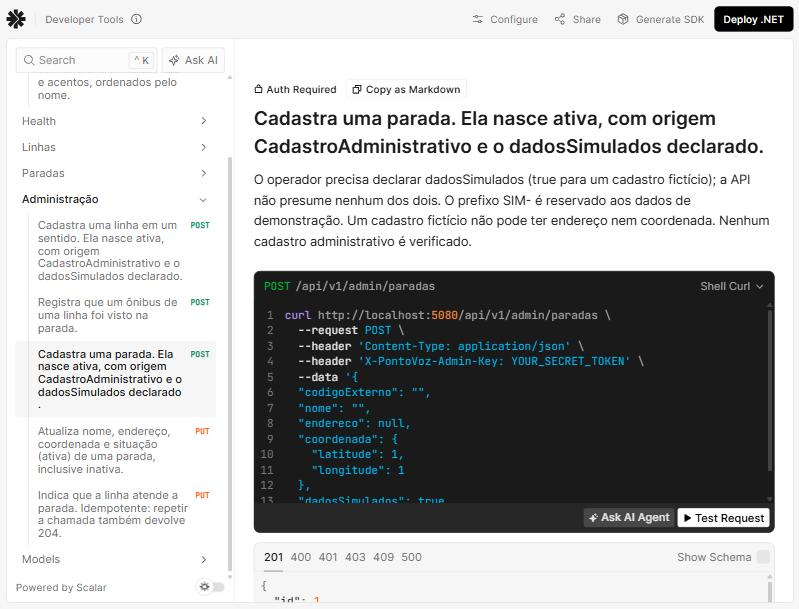

# Evidências — Bloco B7 (operações administrativas)

Execução em 08/11/2026, no Windows 11, com o .NET SDK 10.0.403, a partir da pasta `backend/`.
Os resultados foram copiados das saídas reais. Os cabeçalhos `Date` e `Server` foram omitidos.

O B7 foi feito em duas sessões: a implementação e os testes HTTP, interrompidos por limite de
uso, e a retomada (prompt 09.1), que concluiu os testes dos services e de concorrência, o OpenAPI,
a documentação e estas evidências. Todas as saídas abaixo são da retomada.

## Ambiente das evidências

- **Banco isolado:** um arquivo SQLite temporário, criado com `dotnet ef database update` e a
  variável `ConnectionStrings__PontoVoz` apontando para ele. O `pontovoz.db` de desenvolvimento
  não foi usado nas operações que gravam.
- **Chave:** um valor aleatório gerado para esta execução, passado pela variável de ambiente
  `Admin__Chave` e trocado por `<CHAVE_DE_TESTE>` em toda a saída. Não foi gravado em arquivo.
- **Ids:** lidos das respostas da API, nunca supostos.

```text
> dotnet ef database update --project src/PontoVoz.Api   (banco isolado; últimas linhas)
      VALUES (@p0, @p1, @p2, @p3, @p4, @p5, @p6, @p7)
      RETURNING "Id";
Done.
exit=0
```

## Autorização

API iniciada com `ASPNETCORE_ENVIRONMENT=Production` e **sem** `Admin:Chave`. O aviso de
inicialização e a recusa, mesmo com JSON inválido (a autorização vem antes do corpo):

```text
warn: PontoVoz.Api.Security.AvisoChaveAdministrativa[0]
      As operações administrativas (/api/v1/admin) estão desabilitadas: nenhuma chave em Admin:Chave no ambiente Production.
### POST /api/v1/admin/paradas  { json invalido
HTTP/1.1 403 Forbidden
Content-Type: application/problem+json; charset=utf-8
{"type":"https://tools.ietf.org/html/rfc9110#section-15.5.4","title":"Operações administrativas desabilitadas","status":403,"detail":"As operações administrativas estão desabilitadas porque nenhuma chave foi configurada neste ambiente.","instance":"/api/v1/admin/paradas","traceId":"00-ea239bc9b74ccd8bce5fa2444bb9a37e-55f8d5f9ff1b79d3-00","codigo":"OperacoesAdministrativasDesabilitadas"}

### GET /api/v1/paradas
HTTP/1.1 200 OK
Content-Type: application/json; charset=utf-8
{"itens":[{"id":2,"codigoExterno":"SIM-P002","nome":"Parada Demonstração Avenida","endereco":null,"coordenada":null,"origem":"Simulado","dadosSimulados":true},{"id":1,"codigoExterno":"SIM-P001","nome":"Parada Demonstração Centro","endereco":null,"coordenada":null,"origem":"Simulado","dadosSimulados":true}],"pagina":1,"tamanhoPagina":20,"totalItens":2,"totalPaginas":1}
```

API reiniciada em Development **com** `Admin:Chave` (variável de ambiente). Sem cabeçalho e
com JSON inválido, e depois com uma chave errada:

```text
### POST /api/v1/admin/paradas  { json invalido
HTTP/1.1 401 Unauthorized
Content-Type: application/problem+json; charset=utf-8
WWW-Authenticate: ApiKey header="X-PontoVoz-Admin-Key"
{"type":"https://tools.ietf.org/html/rfc9110#section-15.5.2","title":"Chave administrativa inválida","status":401,"detail":"Informe a chave administrativa correta no cabeçalho X-PontoVoz-Admin-Key.","instance":"/api/v1/admin/paradas","traceId":"00-40ba5907cade5a3b3048afb41056df40-4d619ddfc0e81662-00","codigo":"ChaveAdministrativaInvalida"}
```

```text
### POST /api/v1/admin/paradas  {"codigoExterno":"TESTE-P003","nome":"Parada Cadastro de Teste","dadosSimulados":true}
HTTP/1.1 401 Unauthorized
Content-Type: application/problem+json; charset=utf-8
WWW-Authenticate: ApiKey header="X-PontoVoz-Admin-Key"
{"type":"https://tools.ietf.org/html/rfc9110#section-15.5.2","title":"Chave administrativa inválida","status":401,"detail":"Informe a chave administrativa correta no cabeçalho X-PontoVoz-Admin-Key.","instance":"/api/v1/admin/paradas","traceId":"00-d092cb6c1900c7d99d6fe1bcb320fa0e-2a47b79239db48d4-00","codigo":"ChaveAdministrativaInvalida"}
```

A chave apareceu **0** vezes nos logs das execuções (`grep` do valor real nos arquivos de log).

### user-secrets

Conferência do caminho de configuração em Development: um valor aleatório foi gravado com
`dotnet user-secrets set "Admin:Chave" ...`, a API foi iniciada com o perfil `http` (sem a
variável de ambiente), testada e o segredo foi removido em seguida. O armazenamento de
user-secrets estava vazio antes e ficou vazio depois.

```text
Successfully saved Admin:Chave to the secret store.
sem cabeçalho: 401
com a chave do user-secrets: 400      (a autorização passou; 400 pelo JSON inválido)
Admin:Chave restantes no user-secrets: 0
chave nos logs: 0
```

Development **sem** chave (perfil `http`, sem segredo): a requisição passa pela autorização
(400 pelo JSON inválido), e o log da inicialização avisa:

```text
Development sem chave, JSON inválido: 400
warn: PontoVoz.Api.Security.AvisoChaveAdministrativa[0]
      As operações administrativas (/api/v1/admin) estão SEM proteção por chave: ambiente Development sem Admin:Chave. Use só para demonstração local; configure a chave com dotnet user-secrets ou variável de ambiente.
```

## Fluxo do operador até a consulta pública

Com a chave correta (`X-PontoVoz-Admin-Key: <CHAVE_DE_TESTE>`):

### Cadastro de parada (201), duplicado (409) e corpo inválido (400)

```text
### POST /api/v1/admin/paradas  {"codigoExterno":"TESTE-P003","nome":"Parada Cadastro de Teste","endereco":null,"coordenada":null,"dadosSimulados":true}
HTTP/1.1 201 Created
Content-Type: application/json; charset=utf-8
Location: /api/v1/paradas/3
{"id":3,"codigoExterno":"TESTE-P003","nome":"Parada Cadastro de Teste","endereco":null,"coordenada":null,"origem":"CadastroAdministrativo","dadosSimulados":true,"ativa":true,"criadoEm":"2026-11-08T10:29:45.7918946-03:00"}

id da parada lido da API pública: 3
```

```text
### POST /api/v1/admin/paradas  {"codigoExterno":"TESTE-P003","nome":"Outra","dadosSimulados":true}
HTTP/1.1 409 Conflict
Content-Type: application/problem+json
{"type":"https://tools.ietf.org/html/rfc9110#section-15.5.10","title":"Código já cadastrado","status":409,"detail":"O valor TESTE-P003 do campo codigoExterno já está cadastrado.","instance":"/api/v1/admin/paradas","codigo":"CodigoJaCadastrado","traceId":"00-a2db4282dc953f724fba25d42dc2c061-7bb5af0f66a24d19-00"}
```

```text
### POST /api/v1/admin/paradas  {"codigoExterno":"SIM-X","nome":"ab"}
HTTP/1.1 400 Bad Request
Content-Type: application/problem+json
{"type":"https://tools.ietf.org/html/rfc9110#section-15.5.1","title":"A requisição contém parâmetros inválidos.","status":400,"instance":"/api/v1/admin/paradas","errors":{"codigoExterno":["O prefixo SIM- é reservado aos dados de demonstração."],"nome":["O campo nome deve ter entre 3 e 120 caracteres."],"dadosSimulados":["O campo dadosSimulados é obrigatório."]},"codigo":"RequisicaoInvalida","traceId":"00-9b7962d20bd6b222fda3056a8b2320b1-e7d577f03441c0a7-00"}
```

### Cadastro de linha (201) e associação (204, repetida)

```text
### POST /api/v1/admin/linhas  {"codigo":"TESTE-L005","letreiro":"TESTE-105","terminalPrincipal":"Terminal Demonstração Centro","terminalSecundario":"Terminal Demonstração Sul","sentido":"PrincipalParaSecundario","dadosSimulados":true}
HTTP/1.1 201 Created
Content-Type: application/json; charset=utf-8
{"id":5,"codigo":"TESTE-L005","letreiro":"TESTE-105","terminalPrincipal":"Terminal Demonstração Centro","terminalSecundario":"Terminal Demonstração Sul","sentido":"PrincipalParaSecundario","origem":"CadastroAdministrativo","dadosSimulados":true,"ativa":true,"criadoEm":"2026-11-08T10:29:46.8041008-03:00"}

ids lidos da API pública: TESTE-L005=5 SIM-L003=3
```

```text
### PUT /api/v1/admin/paradas/3/linhas/5
HTTP/1.1 204 No Content

### PUT /api/v1/admin/paradas/3/linhas/5
HTTP/1.1 204 No Content
```

### Observação manual (201) e linha que não atende a parada (422)

```text
### POST /api/v1/admin/observacoes-passagem  {"paradaId":3,"linhaId":5,"observadaEm":"2026-11-08T10:25:47-03:00","prefixoVeiculo":"SIM-V5001","origemRegistro":"operador-local"}
HTTP/1.1 201 Created
Content-Type: application/json; charset=utf-8
{"paradaId":3,"id":3,"linhaId":5,"codigoLinha":"TESTE-L005","letreiro":"TESTE-105","observadaEm":"2026-11-08T10:25:47-03:00","registradaEm":"2026-11-08T10:29:47.7046015-03:00","minutosDesdeObservacao":4,"desatualizada":false,"prefixoVeiculo":"SIM-V5001","nivelConfirmacao":"RegistroManual","verificada":false,"oficialSptrans":false,"origemRegistro":"operador-local","dadosSimulados":true,"aviso":{"codigo":"RegistroManualNaoVerificado","mensagem":"Registro manual sem verificação independente. Não é um dado oficial da SPTrans."}}
```

```text
### POST /api/v1/admin/observacoes-passagem  {"paradaId":3,"linhaId":3,"observadaEm":"2026-11-08T10:25:47-03:00","origemRegistro":"operador-local"}
HTTP/1.1 422 Unprocessable Entity
Content-Type: application/problem+json
{"type":"https://tools.ietf.org/html/rfc4918#section-11.2","title":"Linha não atende a parada","status":422,"detail":"A linha não atende esta parada.","instance":"/api/v1/admin/observacoes-passagem","codigo":"LinhaNaoAtendeParada","traceId":"00-ea329b13fac6f0d327053defa3c5b36f-698b67147054984e-00"}
```

### Consulta pública das últimas passagens

```text
### GET /api/v1/paradas/3/ultimas-passagens
HTTP/1.1 200 OK
Content-Type: application/json; charset=utf-8
{"paradaId":3,"codigoExternoParada":"TESTE-P003","nomeParada":"Parada Cadastro de Teste","dadosSimulados":true,"consultadoEm":"2026-11-08T10:29:48.0950975-03:00","limiteDesatualizacaoMinutos":60,"passagens":[{"id":3,"linhaId":5,"codigoLinha":"TESTE-L005","letreiro":"TESTE-105","observadaEm":"2026-11-08T10:25:47-03:00","registradaEm":"2026-11-08T10:29:47.7046015-03:00","minutosDesdeObservacao":4,"desatualizada":false,"prefixoVeiculo":"SIM-V5001","nivelConfirmacao":"RegistroManual","verificada":false,"oficialSptrans":false,"origemRegistro":"operador-local","dadosSimulados":true,"aviso":{"codigo":"RegistroManualNaoVerificado","mensagem":"Registro manual sem verificação independente. Não é um dado oficial da SPTrans."}}],"linhasSemRegistro":[],"avisos":[{"codigo":"DadosSimulados","mensagem":"Dados simulados para demonstração. Não representam a operação real da SPTrans."},{"codigo":"CadastroNaoVerificado","mensagem":"Cadastro feito por uma rota administrativa, sem conferência com fonte oficial."}]}
```

O registro aparece como `RegistroManual`, com `verificada: false`, `oficialSptrans: false` e o
aviso `RegistroManualNaoVerificado`; a resposta traz `DadosSimulados` e `CadastroNaoVerificado`.

### Desativação (200), associação com parada inativa (422) e consultas públicas

```text
### PUT /api/v1/admin/paradas/3  {"nome":"Parada Cadastro de Teste","endereco":null,"coordenada":null,"ativa":false}
HTTP/1.1 200 OK
Content-Type: application/json; charset=utf-8
{"id":3,"codigoExterno":"TESTE-P003","nome":"Parada Cadastro de Teste","endereco":null,"coordenada":null,"origem":"CadastroAdministrativo","dadosSimulados":true,"ativa":false,"criadoEm":"2026-11-08T10:29:45.7918946-03:00"}
```

```text
### PUT /api/v1/admin/paradas/3/linhas/5
HTTP/1.1 422 Unprocessable Entity
Content-Type: application/problem+json
{"type":"https://tools.ietf.org/html/rfc4918#section-11.2","title":"Parada inativa","status":422,"detail":"A parada está inativa e não recebe novas linhas.","instance":"/api/v1/admin/paradas/3/linhas/5","codigo":"ParadaInativa","traceId":"00-4ae0fe7a86136318092423da2343261d-783ef317a403a2bd-00"}
```

```text
### GET /api/v1/paradas?codigoExterno=TESTE-P003
HTTP/1.1 200 OK
Content-Type: application/json; charset=utf-8
{"itens":[],"pagina":1,"tamanhoPagina":20,"totalItens":0,"totalPaginas":0}
```

```text
### GET /api/v1/paradas/3/ultimas-passagens
HTTP/1.1 404 Not Found
Content-Type: application/problem+json
{"type":"https://tools.ietf.org/html/rfc9110#section-15.5.5","title":"Parada não encontrada","status":404,"detail":"Não existe parada ativa com o id 3.","instance":"/api/v1/paradas/3/ultimas-passagens","codigo":"ParadaNaoEncontrada","traceId":"00-2299f4bd555adfcb807dac1e1a4a34f9-7cbba03aa372de2d-00"}
```

### Persistência no SQLite isolado

Leitura somente leitura do arquivo depois do fluxo: a parada continua gravada (inativa), com a
associação e o registro manual. `TextoBusca` foi preenchido para a busca sem acentos.

```text
Paradas TESTE: [(3, 'TESTE-P003', 0, 'CadastroAdministrativo', 1, 'parada cadastro de teste\nteste-p003')]
Linhas TESTE: [(5, 'TESTE-L005', 1, 'CadastroAdministrativo', 1)]
Associações da parada TESTE: [(3, 5)]
Registros manuais: [(3, 3, 5, 'RegistroManual', 'operador-local', 'SIM-V5001', 1)]
```

## Testes automatizados

```text
dotnet test
Resumo da execução de teste: Aprovado!
  total: 663
  falhou: 0
  concluído com êxito: 663
  ignorados: 0
```

Código de saída 0. Eram 521 testes no fim do B6.1; o B7 acrescentou 142:

| Classe | Testes | O que cobre |
|---|---|---|
| `AdministracaoAutorizacaoTests` | 26 | Matriz de ambiente e chave (Development, Production e Staging), autorização antes do corpo, 401 com `WWW-Authenticate`, 403, chave fora de respostas e logs, aviso de inicialização, rotas públicas sem chave |
| `AdministracaoCadastrosTests` | 42 | Paradas (exemplo do contrato, `Location`, 400 por campo e agrupado, corpo ausente ou não JSON, 409 inclusive com parada inativa, atualização, desativação e reativação, busca sem acentos após renomear, histórico preservado, 404), linhas (exemplo, sentidos, 400, 409, consulta pública) e associação (204 repetido em requisições diferentes sem duplicar no SQLite, 404, 422) |
| `ObservacoesPassagemHttpTests` | 36 | Exemplo do contrato reproduzido pela API (resposta e `ultimas-passagens.json`), J1 a J5, T5 e T6, tolerância futura, prefixo por natureza, `origemRegistro`, fuso obrigatório, número como texto, 404, 422, UTC no SQLite, seed não renovado |
| `AdministracaoFluxoCompletoTests` | 1 | Fluxo do operador com a chave exigida, até a consulta pública e a desativação |
| `AdministracaoServicesTests` | 23 | Services sem banco: validação antes de ler ou gravar, erros esperados, 409 na corrida, associação idempotente na corrida, `CancellationToken`, leitura única do `TimeProvider`, regras do domínio |
| `UnidadeTrabalhoEfTests` | 12 | SQLite real: dois cadastros com o mesmo código (código 2067), cadastro com outra requisição gravando no meio (409), associação simultânea (código 1555, sem duplicar), chave estrangeira (787) que não vira 409, classificação dos códigos |
| `InfraestruturaHttpTests` | +2 | OpenAPI com 11 operações e 405 para operações administrativas fora do contrato |

## Build, migrations e contrato

```text
dotnet restore                                        -> exit 0, "Todos os projetos estão atualizados para restauração."
dotnet build                                          -> exit 0, 0 Aviso(s), 0 Erro(s)
dotnet test                                           -> exit 0, 663 aprovados, 0 falhas, 0 ignorados
dotnet ef migrations list --project src/PontoVoz.Api  -> exit 0
    20261107211456_InitialCreate
    20261107222533_AddSearchColumns
dotnet ef database update --project src/PontoVoz.Api  -> exit 0, "Done."
dotnet ef migrations has-pending-model-changes --project src/PontoVoz.Api
                                                      -> exit 0, "No changes have been made to the model since the last migration."
dotnet run contracts/verificador/VerificarContrato.cs  -> exit 0, "Nenhuma falha nas regras verificadas."
```

O B7 não criou migration: as tabelas, o índice único dos códigos e a chave composta das
associações já existiam desde o B3. O `database update` no banco de desenvolvimento não aplicou
nada (as únicas escritas do log são a trava temporária `__EFMigrationsLock` do EF Core), e a
inspeção somente leitura do `pontovoz.db` antes e depois de todo o B7 deu o mesmo resultado do fim
do B6.

## OpenAPI e Scalar

`pwsh ./scripts/exportar-openapi.ps1` exportou `contracts/openapi/pontovoz-v1.json`, igual ao
documento gerado pela API (teste `OpenApiExportado_EstaIgualAoDocumentoGeradoPelaApi`):

```text
11 operações
  POST /api/v1/admin/linhas ['201', '400', '401', '403', '409', '500'] security
  POST /api/v1/admin/observacoes-passagem ['201', '400', '401', '403', '404', '422', '500'] security
  POST /api/v1/admin/paradas ['201', '400', '401', '403', '409', '500'] security
  PUT /api/v1/admin/paradas/{id} ['200', '400', '401', '403', '404', '500'] security
  PUT /api/v1/admin/paradas/{id}/linhas/{linhaId} ['204', '401', '403', '404', '422', '500'] security
  GET /api/v1/destinos ['200', '400', '500']
  GET /api/v1/linhas ['200', '400', '500']
  GET /api/v1/paradas ['200', '400', '500']
  GET /api/v1/paradas/{id} ['200', '404', '500']
  GET /api/v1/paradas/{id}/ultimas-passagens ['200', '400', '404', '422', '500']
  GET /health ['200', '503']
securitySchemes: ['ChaveAdministrativa']   (apiKey no cabeçalho X-PontoVoz-Admin-Key, sem valor)
CadastroParadaDto required= ['codigoExterno', 'nome', 'dadosSimulados']
AtualizacaoParadaDto required= ['nome', 'ativa']
CadastroLinhaDto required= ['codigo', 'letreiro', 'terminalPrincipal', 'terminalSecundario', 'sentido', 'dadosSimulados']
ObservacaoPassagemDto required= ['paradaId', 'linhaId', 'observadaEm', 'origemRegistro']
```

`endereco`, `coordenada` e `prefixoVeiculo` são opcionais. Nenhuma operação de previsões,
alternativas ou resumo aparece.

Interface Scalar (`/scalar/`), grupo **Administração**, com "Auth Required" e o cabeçalho da
chave (o valor mostrado é o marcador do próprio Scalar, não uma chave):



## Problemas encontrados e soluções

| Problema | Solução |
|---|---|
| Um `bool` ou enum omitido no JSON chegaria como `false` ou como o primeiro valor do enum | Campos de entrada anuláveis; o service devolve 400 "obrigatório" |
| O conversor padrão aceitaria `observadaEm` sem fuso, completando com o fuso do servidor | `DataHoraComFusoConverter` exige `Z` ou `±hh:mm` |
| `[Consumes]` e o filtro padrão devolveriam 415 sem `codigo` para corpo não JSON | O filtro foi retirado; o caso vira 400 `RequisicaoInvalida` em `errors.corpo`, como prevê a seção 7 |
| O OpenAPI marcava como obrigatórios todos os parâmetros dos records, inclusive `endereco` e `coordenada` | Atributo `[CampoObrigatorio]` e transformadores do documento |
| Números aceitos também como texto (`"5"`) e documentados como `integer \| string` | `NumberHandling.Strict` no `JsonContrato`: só números; as respostas não mudaram |
| `FakeTimeProvider` não volta no tempo, e o relógio dos testes começava às 14h32 | Opção `inicioRelogio` no `ApiTeste` |
| A frase do contrato dizia que telefones não passam em `origemRegistro`; um número só de dígitos passa | Frase corrigida no contrato e no README, sem mudar a regra (pendência para a auditoria) |
| Interrupção por limite de uso no meio do B7 | Retomada sem descartar nada: o trabalho local foi conferido com `git status` e os testes antes de continuar |
