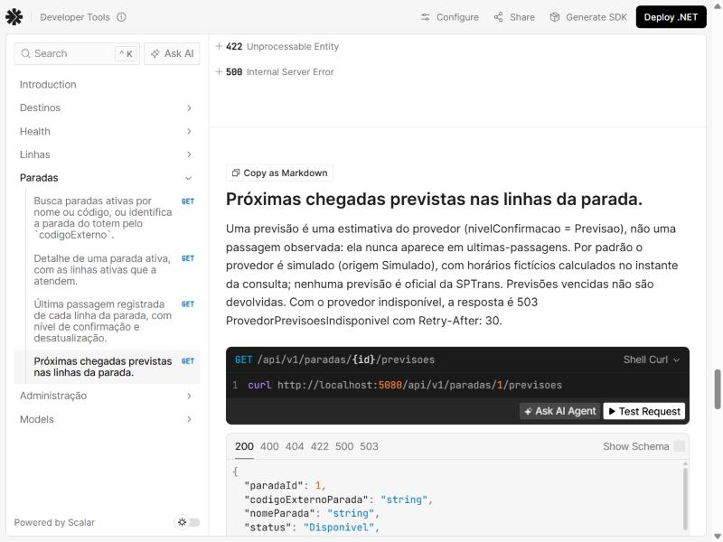

# Evidências — Bloco B8 (previsões de chegada)

Execução em 08/11/2026, no Windows 11, com o .NET SDK 10.0.403, a partir da pasta `backend/`.
Os resultados foram copiados das saídas reais. Os cabeçalhos `Date` e `Server` foram omitidos.

## API real com o provedor simulado

A API foi iniciada em Development sobre um SQLite **isolado** (criado com `dotnet ef database
update` e a variável `ConnectionStrings__PontoVoz`), com o **relógio real** do servidor. Os ids
foram lidos da própria API.

```text
ids lidos da API: SIM-P001=1 SIM-L001=1 SIM-L003=3 SIM-L004=4
horário do servidor (UTC): 2026-11-08T14:31:47Z
```

### 200 com previsão parcial (todas as linhas da parada)

Às 11h31min48s de 08/11/2026, a grade das linhas de demonstração deu SIM-L002 às 11h33 e 11h51 e
SIM-L004 às 11h40, com SIM-L001 sem previsão. É a mesma grade do exemplo do contrato (14h33,
14h40, 14h51 em 10/11/2026), em outro dia e horário, sem nenhuma data gravada no código; o
veículo da primeira viagem da SIM-L002 é outro (SIM-V2002) porque os veículos fazem rodízio pela
grade.

```text
### GET /api/v1/paradas/1/previsoes
HTTP/1.1 200 OK
Content-Type: application/json; charset=utf-8
{"paradaId":1,"codigoExternoParada":"SIM-P001","nomeParada":"Parada Demonstração Centro","status":"Disponivel","origem":"Simulado","dadosSimulados":true,"consultadoEm":"2026-11-08T11:31:48.1378926-03:00","previsoes":[{"linhaId":2,"codigoLinha":"SIM-L002","letreiro":"SIM-102","previstaPara":"2026-11-08T11:33:00-03:00","esperaMinutos":1,"prefixoVeiculo":"SIM-V2002","nivelConfirmacao":"Previsao"},{"linhaId":4,"codigoLinha":"SIM-L004","letreiro":"SIM-104","previstaPara":"2026-11-08T11:40:00-03:00","esperaMinutos":8,"prefixoVeiculo":"SIM-V4001","nivelConfirmacao":"Previsao"},{"linhaId":2,"codigoLinha":"SIM-L002","letreiro":"SIM-102","previstaPara":"2026-11-08T11:51:00-03:00","esperaMinutos":19,"prefixoVeiculo":"SIM-V2003","nivelConfirmacao":"Previsao"}],"linhasSemPrevisao":[{"linhaId":1,"codigoLinha":"SIM-L001","letreiro":"SIM-101"}],"avisos":[{"codigo":"DadosSimulados","mensagem":"Dados simulados para demonstração. Não representam a operação real da SPTrans."},{"codigo":"PrevisaoParcial","mensagem":"Não há previsão de chegada para algumas linhas desta parada."}]}
```

### 200 com previsão para todas as linhas consultadas (`linhaId` da SIM-L004)

```text
### GET /api/v1/paradas/1/previsoes?linhaId=4
HTTP/1.1 200 OK
Content-Type: application/json; charset=utf-8
{"paradaId":1,"codigoExternoParada":"SIM-P001","nomeParada":"Parada Demonstração Centro","status":"Disponivel","origem":"Simulado","dadosSimulados":true,"consultadoEm":"2026-11-08T11:31:48.5030601-03:00","previsoes":[{"linhaId":4,"codigoLinha":"SIM-L004","letreiro":"SIM-104","previstaPara":"2026-11-08T11:40:00-03:00","esperaMinutos":8,"prefixoVeiculo":"SIM-V4001","nivelConfirmacao":"Previsao"}],"linhasSemPrevisao":[],"avisos":[{"codigo":"DadosSimulados","mensagem":"Dados simulados para demonstração. Não representam a operação real da SPTrans."}]}
```

### 200 sem previsões (`linhaId` da SIM-L001, sem configuração simulada)

```text
### GET /api/v1/paradas/1/previsoes?linhaId=1
HTTP/1.1 200 OK
Content-Type: application/json; charset=utf-8
{"paradaId":1,"codigoExternoParada":"SIM-P001","nomeParada":"Parada Demonstração Centro","status":"SemPrevisoes","origem":"Simulado","dadosSimulados":true,"consultadoEm":"2026-11-08T11:31:48.6728929-03:00","previsoes":[],"linhasSemPrevisao":[{"linhaId":1,"codigoLinha":"SIM-L001","letreiro":"SIM-101"}],"avisos":[{"codigo":"DadosSimulados","mensagem":"Dados simulados para demonstração. Não representam a operação real da SPTrans."},{"codigo":"SemPrevisoes","mensagem":"Não há previsão de chegada para as linhas desta parada no momento."}]}
```

### 200 para parada sem linhas (cadastrada pela rota administrativa, sem associação)

```text
### GET /api/v1/paradas/3/previsoes
HTTP/1.1 200 OK
Content-Type: application/json; charset=utf-8
{"paradaId":3,"codigoExternoParada":"TESTE-P801","nomeParada":"Parada Sem Linhas","status":"SemPrevisoes","origem":"Simulado","dadosSimulados":true,"consultadoEm":"2026-11-08T11:31:49.6468506-03:00","previsoes":[],"linhasSemPrevisao":[],"avisos":[{"codigo":"DadosSimulados","mensagem":"Dados simulados para demonstração. Não representam a operação real da SPTrans."},{"codigo":"CadastroNaoVerificado","mensagem":"Cadastro feito por uma rota administrativa, sem conferência com fonte oficial."},{"codigo":"ParadaSemLinhas","mensagem":"Nenhuma linha está associada a esta parada."}]}
```

### 400, 404 e 422

```text
### GET /api/v1/paradas/1/previsoes?linhaId=abc
HTTP/1.1 400 Bad Request
Content-Type: application/problem+json; charset=utf-8
{"type":"https://tools.ietf.org/html/rfc9110#section-15.5.1","title":"A requisição contém parâmetros inválidos.","status":400,"instance":"/api/v1/paradas/1/previsoes","errors":{"linhaId":["O valor informado para linhaId é inválido."]},"traceId":"00-06564621907bbb75820a387b552b8b3c-08505df5a0ab21a0-00","codigo":"RequisicaoInvalida"}
```

```text
### GET /api/v1/paradas/99/previsoes
HTTP/1.1 404 Not Found
Content-Type: application/problem+json
{"type":"https://tools.ietf.org/html/rfc9110#section-15.5.5","title":"Parada não encontrada","status":404,"detail":"Não existe parada ativa com o id 99.","instance":"/api/v1/paradas/99/previsoes","codigo":"ParadaNaoEncontrada","traceId":"00-85841cee35b7eac3833a355584369f58-6da209ed9cf36fd5-00"}
```

```text
### GET /api/v1/paradas/1/previsoes?linhaId=3
HTTP/1.1 422 Unprocessable Entity
Content-Type: application/problem+json
{"type":"https://tools.ietf.org/html/rfc4918#section-11.2","title":"Linha não atende a parada","status":422,"detail":"A linha 3 não atende a parada 1.","instance":"/api/v1/paradas/1/previsoes","codigo":"LinhaNaoAtendeParada","traceId":"00-2e082b98b4b31b6d349ebf10e67cf052-8360682079e01ed1-00"}
```

### Nada é gravado

Contagem das tabelas do SQLite isolado antes e depois de 6 consultas de previsões (a única
diferença é a parada `TESTE-P801`, criada pela rota administrativa para o caso "sem linhas"):

```text
contagens antes: {'Paradas': 2, 'Linhas': 4, 'ParadasLinhas': 5, 'RegistrosPassagem': 2}
contagens depois de 6 consultas de previsões (a parada TESTE-P801 foi criada pela rota administrativa): {'Paradas': 3, 'Linhas': 4, 'ParadasLinhas': 5, 'RegistrosPassagem': 2}
```

## 503 com `Retry-After` (indisponibilidade simulada, R6)

A API foi reiniciada com a variável `Previsoes__SimularIndisponibilidade=true`, sem mudar código
nem banco:

```text
### GET /api/v1/paradas/1/previsoes
HTTP/1.1 503 Service Unavailable
Content-Type: application/problem+json
Retry-After: 30
{"type":"https://tools.ietf.org/html/rfc9110#section-15.6.4","title":"Previsões indisponíveis","status":503,"detail":"O serviço de previsões não está disponível no momento. Tente novamente em instantes.","instance":"/api/v1/paradas/1/previsoes","codigo":"ProvedorPrevisoesIndisponivel","traceId":"00-add2ed1b63103f63884e210f0a2fa8ab-c4cd4c10e1816cfc-00"}
```

A parada sem linhas continua 200, porque o provedor não é consultado, e as outras consultas
continuam funcionando:

```text
### GET /api/v1/paradas/3/previsoes
HTTP/1.1 200 OK
Content-Type: application/json; charset=utf-8
{"paradaId":3,"codigoExternoParada":"TESTE-P801","nomeParada":"Parada Sem Linhas","status":"SemPrevisoes","origem":"Simulado","dadosSimulados":true,"consultadoEm":"2026-11-08T11:32:01.2676463-03:00","previsoes":[],"linhasSemPrevisao":[],"avisos":[{"codigo":"DadosSimulados","mensagem":"Dados simulados para demonstração. Não representam a operação real da SPTrans."},{"codigo":"CadastroNaoVerificado","mensagem":"Cadastro feito por uma rota administrativa, sem conferência com fonte oficial."},{"codigo":"ParadaSemLinhas","mensagem":"Nenhuma linha está associada a esta parada."}]}

outras consultas: /api/v1/paradas -> 200  ultimas-passagens -> 200  /health -> 200
```

```text
outras consultas: /api/v1/paradas -> 200  ultimas-passagens -> 200  /health -> 200
```

## Olho Vivo: sem chamadas reais

```text
chamadas à SPTrans nos logs: 0 linha(s)
```

Nas execuções acima, o adaptador estava desligado (padrão) e não havia token configurado: os logs
não registram nenhuma chamada à SPTrans. Os testes do adaptador usam um `HttpMessageHandler`
falso e nunca acessam a rede. **Nenhum teste contra a API real da SPTrans foi feito**, e o
projeto não tem token de acesso; os testes provam o tratamento das respostas e das falhas no
formato da documentação oficial, não o funcionamento da integração real (veja
[`../../../docs/dados.md`](../../../docs/dados.md)).

Segurança das credenciais:

- O token só é lido de `Previsoes:OlhoVivo:Token` (user-secrets ou variável de ambiente); o
  `appsettings.json` não tem essa chave.
- O registro automático de requisições do `HttpClient` foi desligado para o adaptador, porque
  gravaria a URL de login com o token. Os testes `AutenticacaoERespostaValidas_ViramPrevisoesOlhoVivo`,
  `AutenticacaoRecusada_FicaIndisponivelSemConsultarPrevisao` e
  `OlhoVivoHabilitado_ParadaComCodigoOficial_UsaOAdaptador_EDadosSimContinuamSimulados` conferem
  que o token fictício não aparece nos logs nem nas respostas.
- O adaptador só aceita endereço HTTPS.

## Testes automatizados

```text
dotnet test
Resumo da execução de teste: Aprovado!
  total: 756
  falhou: 0
  concluído com êxito: 756
  ignorados: 0
```

Código de saída 0, com os binários recompilados do zero (`dotnet build --no-incremental`). Eram
663 testes no fim do B7; o B8 acrescentou 94 e retirou 1 caso (a rota de previsões saiu da lista
de rotas ainda inexistentes).

| Classe | Testes | O que cobre |
|---|---|---|
| `ProvedorPrevisaoSimuladoTests` | 22 | Exemplo do contrato; grade em 6 datas diferentes (futuro, espaçamento, rodízio de veículos); chegada no instante exato (espera 0); 1 s depois (não volta vencida); espera com 0, 1, 30 e 59 s; virada de mês e de ano à meia-noite; mesmo resultado depois de recriar o provedor; repetição em datas diferentes; linhas sem configuração; várias chegadas da mesma linha; indisponibilidade; cancelamento; nenhum comando SQL |
| `ProvedorOlhoVivoTests` | 32 | Autenticação e resposta válidas; veículo sem horário ou com prefixo inválido; resposta sem veículos; autenticação recusada; erro HTTP; falha de conexão; prazo esgotado; cancelamento do cliente; JSON inválido ou sem campos obrigatórios; desabilitado ou sem token (nenhuma chamada); dados `SIM-` e parada sem código oficial nunca enviados; horário `HH:mm` perto da meia-noite; seleção do provedor; falha da Olho Vivo sem troca por previsões simuladas |
| `PrevisoesServiceTests` | 19 | Parada válida; instante único; todas as linhas; parcial; sem previsões; indisponível (503); parada sem linhas sem consultar o provedor; `linhaId`; ordem determinística; `linhaId` inválido; parada inexistente, inativa ou com id inválido; linha inexistente ou inativa; linha que não atende; cadastros administrativos; ordem dos avisos; `CancellationToken` |
| `PrevisoesHttpTests` | 21 | Igualdade com `previsoes.json`; tipos e ordem do JSON; filtro por linha; sem previsões; parada sem linhas com o provedor indisponível; acesso público sem chave; 400, 404 e 422 antes do provedor; 503 igual ao exemplo, com `Retry-After: 30`; outras consultas com o provedor indisponível; nada gravado e últimas passagens inalteradas; Olho Vivo com HTTP falso pela API real; falha da Olho Vivo em 503 sem vazar dados; cancelamento |

Os horários dos testes nunca dependem do relógio real: são instantes informados pelo teste ou um
`FakeTimeProvider`.

## Build, migrations e contrato

```text
dotnet restore                                        -> exit 0, "Todos os projetos estão atualizados para restauração."
dotnet build --no-incremental                         -> exit 0, 0 Aviso(s), 0 Erro(s)
dotnet test                                           -> exit 0, 756 aprovados, 0 falhas, 0 ignorados
dotnet ef migrations list --project src/PontoVoz.Api  -> exit 0
    20261107211456_InitialCreate
    20261107222533_AddSearchColumns
dotnet ef database update --project src/PontoVoz.Api  -> exit 0, "Done."
dotnet ef migrations has-pending-model-changes --project src/PontoVoz.Api
                                                      -> exit 0, "No changes have been made to the model since the last migration."
dotnet run contracts/verificador/VerificarContrato.cs  -> exit 0, "Nenhuma falha nas regras verificadas."
```

O B8 não criou migration: as previsões não são persistidas. A inspeção somente leitura do
`pontovoz.db` de desenvolvimento antes e depois das validações deu o mesmo resultado.

## OpenAPI e Scalar

`pwsh ./scripts/exportar-openapi.ps1` exportou `contracts/openapi/pontovoz-v1.json`, igual ao
documento gerado pela API (teste `OpenApiExportado_EstaIgualAoDocumentoGeradoPelaApi`):

```text
operações: 12
previsoes: ObterPrevisoes ['200', '400', '404', '422', '500', '503'] | params: [('id', 'path'), ('linhaId', 'query')]
503: {"description": "Service Unavailable", "headers": {"Retry-After": {"description": "Segundos até uma nova tentativa (sempre 30).", "schema": {"type": "integer"}}}, ...}
PrevisoesParadaDto: ['paradaId', 'codigoExternoParada', 'nomeParada', 'status', 'origem', 'dadosSimulados', 'consultadoEm', 'previsoes', 'linhasSemPrevisao', 'avisos']
PrevisaoDto: ['linhaId', 'codigoLinha', 'letreiro', 'previstaPara', 'esperaMinutos', 'prefixoVeiculo', 'nivelConfirmacao']
alternativas/resumo como rota: []
token/olhovivo no doc: False False
```

Interface Scalar com a operação de previsões, a explicação da diferença entre previsão e passagem
e as respostas 200, 400, 404, 422, 500 e 503:



## Problemas encontrados e soluções

| Problema | Solução |
|---|---|
| `JsonElement.TryGetInt32` lança exceção (em vez de devolver `false`) quando `cl` vem como texto; um JSON inesperado da SPTrans viraria 500 | O adaptador confere o tipo antes; o caso tem teste e vira indisponibilidade (503) |
| A sessão da Olho Vivo depois do login não está descrita na página oficial | O adaptador guarda cookies e autentica a cada consulta; o ponto está registrado em `docs/dados.md` como não confirmado |
| O registro automático de requisições do `HttpClient` gravaria a URL de login com o token | `RemoveAllLoggers()` no cliente do adaptador, com teste do token fora dos logs |
| Um prazo configurado como 0 ou negativo faria o `CancelAfter` falhar | Prazo mínimo de 1 segundo (`OpcoesOlhoVivo.Prazo`) |
| A seção 11 do contrato ainda dizia que nenhum requisito estava implementado | Nota com o estado de cada requisito, sem mudar os requisitos |
