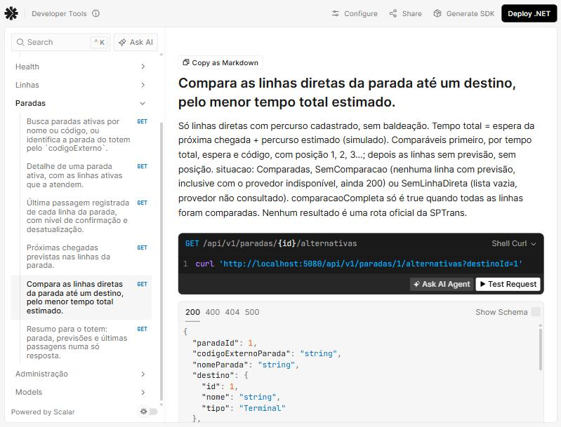

# Evidências — Bloco B9 (alternativas de deslocamento e resumo do totem)

Execução em 08/11/2026, no Windows 11, com o .NET SDK 10.0.403, a partir da pasta `backend/`.
Os resultados foram copiados das saídas reais. Os cabeçalhos `Date` e `Server` foram omitidos, e
os corpos JSON longos foram formatados para leitura, sem mudar o conteúdo.

## API real

A API foi iniciada em Development sobre um SQLite **isolado** e novo (criado com
`dotnet ef database update` e a variável `ConnectionStrings__PontoVoz`), com o **relógio real** do
servidor e o provedor de previsões simulado. Os ids foram lidos da própria API.

```text
ids lidos da API: SIM-P001=1 SIM-P002=2 Terminal Norte=3 Terminal Sul=2
horário do servidor (UTC): 2026-11-08T15:33:41Z
```

### Ranking: a SIM-L004 na frente da SIM-L002

Às 12h33 de 08/11/2026, a SIM-L004 chegava em 6 minutos e levava 20 até o Terminal Norte (26 no
total); a SIM-L002 chegava em 11 e levava 40 (51 no total). A SIM-L001 não tem previsão: aparece
por último, sem posição, e a comparação fica incompleta.

```text
### GET /api/v1/paradas/1/alternativas?destinoId=3
HTTP/1.1 200 OK
Content-Type: application/json; charset=utf-8
{
  "paradaId": 1,
  "codigoExternoParada": "SIM-P001",
  "nomeParada": "Parada Demonstração Centro",
  "destino": {
    "id": 3,
    "nome": "Terminal Demonstração Norte",
    "tipo": "Terminal"
  },
  "criterio": "MenorTempoTotalEstimado",
  "situacao": "Comparadas",
  "comparacaoCompleta": false,
  "statusPrevisao": "Disponivel",
  "origemPrevisao": "Simulado",
  "dadosSimulados": true,
  "consultadoEm": "2026-11-08T12:33:42.1582288-03:00",
  "alternativas": [
    {
      "posicao": 1,
      "linhaId": 4,
      "codigoLinha": "SIM-L004",
      "letreiro": "SIM-104",
      "situacao": "Comparavel",
      "previstaPara": "2026-11-08T12:40:00-03:00",
      "esperaMinutos": 6,
      "percursoEstimadoMinutos": 20,
      "tempoTotalEstimadoMinutos": 26,
      "chegadaEstimadaAoDestino": "2026-11-08T13:00:00-03:00",
      "baldeacoes": 0,
      "origemPercurso": "Simulado"
    },
    {
      "posicao": 2,
      "linhaId": 2,
      "codigoLinha": "SIM-L002",
      "letreiro": "SIM-102",
      "situacao": "Comparavel",
      "previstaPara": "2026-11-08T12:45:00-03:00",
      "esperaMinutos": 11,
      "percursoEstimadoMinutos": 40,
      "tempoTotalEstimadoMinutos": 51,
      "chegadaEstimadaAoDestino": "2026-11-08T13:25:00-03:00",
      "baldeacoes": 0,
      "origemPercurso": "Simulado"
    },
    {
      "posicao": null,
      "linhaId": 1,
      "codigoLinha": "SIM-L001",
      "letreiro": "SIM-101",
      "situacao": "SemPrevisao",
      "previstaPara": null,
      "esperaMinutos": null,
      "percursoEstimadoMinutos": 30,
      "tempoTotalEstimadoMinutos": null,
      "chegadaEstimadaAoDestino": null,
      "baldeacoes": 0,
      "origemPercurso": "Simulado"
    }
  ],
  "avisos": [
    {
      "codigo": "DadosSimulados",
      "mensagem": "Dados simulados para demonstração. Não representam a operação real da SPTrans."
    },
    {
      "codigo": "LimitacaoLinhasDiretas",
      "mensagem": "Considera apenas linhas diretas desta parada, sem baldeação nem outros meios de transporte."
    },
    {
      "codigo": "PercursoEstimado",
      "mensagem": "Os tempos de percurso são estimativas simuladas para demonstração e não consideram o trânsito em tempo real."
    },
    {
      "codigo": "ComparacaoIncompleta",
      "mensagem": "Algumas linhas não têm previsão de chegada e ficaram fora da comparação."
    }
  ]
}
```

### Comparação completa (SIM-P002 até o Terminal Sul)

```text
### GET /api/v1/paradas/2/alternativas?destinoId=2
HTTP/1.1 200 OK
Content-Type: application/json; charset=utf-8
{
  "paradaId": 2,
  "codigoExternoParada": "SIM-P002",
  "nomeParada": "Parada Demonstração Avenida",
  "destino": {
    "id": 2,
    "nome": "Terminal Demonstração Sul",
    "tipo": "Terminal"
  },
  "criterio": "MenorTempoTotalEstimado",
  "situacao": "Comparadas",
  "comparacaoCompleta": true,
  "statusPrevisao": "Disponivel",
  "origemPrevisao": "Simulado",
  "dadosSimulados": true,
  "consultadoEm": "2026-11-08T12:33:42.6268242-03:00",
  "alternativas": [
    {
      "posicao": 1,
      "linhaId": 3,
      "codigoLinha": "SIM-L003",
      "letreiro": "SIM-203",
      "situacao": "Comparavel",
      "previstaPara": "2026-11-08T12:47:00-03:00",
      "esperaMinutos": 13,
      "percursoEstimadoMinutos": 25,
      "tempoTotalEstimadoMinutos": 38,
      "chegadaEstimadaAoDestino": "2026-11-08T13:12:00-03:00",
      "baldeacoes": 0,
      "origemPercurso": "Simulado"
    }
  ],
  "avisos": [
    {
      "codigo": "DadosSimulados",
      "mensagem": "Dados simulados para demonstração. Não representam a operação real da SPTrans."
    },
    {
      "codigo": "LimitacaoLinhasDiretas",
      "mensagem": "Considera apenas linhas diretas desta parada, sem baldeação nem outros meios de transporte."
    },
    {
      "codigo": "PercursoEstimado",
      "mensagem": "Os tempos de percurso são estimativas simuladas para demonstração e não consideram o trânsito em tempo real."
    }
  ]
}
```

### Sem linha direta (SIM-P001 até o Terminal Sul)

Nenhum percurso cadastrado: lista vazia, `statusPrevisao` e `origemPrevisao` nulos e o provedor não
é consultado.

```text
### GET /api/v1/paradas/1/alternativas?destinoId=2
HTTP/1.1 200 OK
Content-Type: application/json; charset=utf-8
{
  "paradaId": 1,
  "codigoExternoParada": "SIM-P001",
  "nomeParada": "Parada Demonstração Centro",
  "destino": {
    "id": 2,
    "nome": "Terminal Demonstração Sul",
    "tipo": "Terminal"
  },
  "criterio": "MenorTempoTotalEstimado",
  "situacao": "SemLinhaDireta",
  "comparacaoCompleta": false,
  "statusPrevisao": null,
  "origemPrevisao": null,
  "dadosSimulados": true,
  "consultadoEm": "2026-11-08T12:33:42.8205477-03:00",
  "alternativas": [],
  "avisos": [
    {
      "codigo": "SemLinhaDireta",
      "mensagem": "Não há linha direta cadastrada desta parada até o destino."
    },
    {
      "codigo": "DadosSimulados",
      "mensagem": "Dados simulados para demonstração. Não representam a operação real da SPTrans."
    },
    {
      "codigo": "LimitacaoLinhasDiretas",
      "mensagem": "Considera apenas linhas diretas desta parada, sem baldeação nem outros meios de transporte."
    }
  ]
}
```

### 400 e 404

```text
### GET /api/v1/paradas/1/alternativas
HTTP/1.1 400 Bad Request
Content-Type: application/problem+json
{"type":"https://tools.ietf.org/html/rfc9110#section-15.5.1","title":"A requisição contém parâmetros inválidos.","status":400,"instance":"/api/v1/paradas/1/alternativas","errors":{"destinoId":["O campo destinoId é obrigatório."]},"codigo":"RequisicaoInvalida","traceId":"00-9a9be8f84f3dff57dca4e5f997293900-a748082a5de77b1a-00"}
```

```text
### GET /api/v1/paradas/1/alternativas?destinoId=999
HTTP/1.1 404 Not Found
Content-Type: application/problem+json
{"type":"https://tools.ietf.org/html/rfc9110#section-15.5.5","title":"Destino não encontrado","status":404,"detail":"Não existe destino ativo com o id 999.","instance":"/api/v1/paradas/1/alternativas","codigo":"DestinoNaoEncontrado","traceId":"00-5fdf03526e91ae629730f6c86c6f3d01-23ccdd09b9d1295a-00"}
```

```text
### GET /api/v1/paradas/99/resumo
HTTP/1.1 404 Not Found
Content-Type: application/problem+json
{"type":"https://tools.ietf.org/html/rfc9110#section-15.5.5","title":"Parada não encontrada","status":404,"detail":"Não existe parada ativa com o id 99.","instance":"/api/v1/paradas/99/resumo","codigo":"ParadaNaoEncontrada","traceId":"00-380812213e762d618817ea9023a5669a-edaadf116a4b5aec-00"}
```

### Resumo completo

Os três `consultadoEm` são o mesmo instante. A previsão parcial (SIM-L001 sem previsão) não torna o
resumo parcial.

```text
### GET /api/v1/paradas/1/resumo
HTTP/1.1 200 OK
Content-Type: application/json; charset=utf-8
{
  "consultadoEm": "2026-11-08T12:33:43.4314658-03:00",
  "dadosSimulados": true,
  "situacao": "Completo",
  "partesIndisponiveis": [],
  "parada": {
    "id": 1,
    "codigoExterno": "SIM-P001",
    "nome": "Parada Demonstração Centro",
    "endereco": null,
    "coordenada": null,
    "origem": "Simulado",
    "dadosSimulados": true,
    "linhas": [
      {
        "id": 1,
        "codigo": "SIM-L001",
        "letreiro": "SIM-101",
        "terminalPrincipal": "Terminal Demonstração Centro",
        "terminalSecundario": "Terminal Demonstração Norte",
        "sentido": "PrincipalParaSecundario",
        "origem": "Simulado",
        "dadosSimulados": true
      },
      {
        "id": 2,
        "codigo": "SIM-L002",
        "letreiro": "SIM-102",
        "terminalPrincipal": "Terminal Demonstração Centro",
        "terminalSecundario": "Terminal Demonstração Norte",
        "sentido": "PrincipalParaSecundario",
        "origem": "Simulado",
        "dadosSimulados": true
      },
      {
        "id": 4,
        "codigo": "SIM-L004",
        "letreiro": "SIM-104",
        "terminalPrincipal": "Terminal Demonstração Centro",
        "terminalSecundario": "Terminal Demonstração Norte",
        "sentido": "PrincipalParaSecundario",
        "origem": "Simulado",
        "dadosSimulados": true
      }
    ]
  },
  "previsoes": {
    "paradaId": 1,
    "codigoExternoParada": "SIM-P001",
    "nomeParada": "Parada Demonstração Centro",
    "status": "Disponivel",
    "origem": "Simulado",
    "dadosSimulados": true,
    "consultadoEm": "2026-11-08T12:33:43.4314658-03:00",
    "previsoes": [
      {
        "linhaId": 4,
        "codigoLinha": "SIM-L004",
        "letreiro": "SIM-104",
        "previstaPara": "2026-11-08T12:40:00-03:00",
        "esperaMinutos": 6,
        "prefixoVeiculo": "SIM-V4001",
        "nivelConfirmacao": "Previsao"
      },
      {
        "linhaId": 2,
        "codigoLinha": "SIM-L002",
        "letreiro": "SIM-102",
        "previstaPara": "2026-11-08T12:45:00-03:00",
        "esperaMinutos": 11,
        "prefixoVeiculo": "SIM-V2003",
        "nivelConfirmacao": "Previsao"
      },
      {
        "linhaId": 2,
        "codigoLinha": "SIM-L002",
        "letreiro": "SIM-102",
        "previstaPara": "2026-11-08T13:03:00-03:00",
        "esperaMinutos": 29,
        "prefixoVeiculo": "SIM-V2001",
        "nivelConfirmacao": "Previsao"
      }
    ],
    "linhasSemPrevisao": [
      {
        "linhaId": 1,
        "codigoLinha": "SIM-L001",
        "letreiro": "SIM-101"
      }
    ],
    "avisos": [
      {
        "codigo": "DadosSimulados",
        "mensagem": "Dados simulados para demonstração. Não representam a operação real da SPTrans."
      },
      {
        "codigo": "PrevisaoParcial",
        "mensagem": "Não há previsão de chegada para algumas linhas desta parada."
      }
    ]
  },
  "ultimasPassagens": {
    "paradaId": 1,
    "codigoExternoParada": "SIM-P001",
    "nomeParada": "Parada Demonstração Centro",
    "dadosSimulados": true,
    "consultadoEm": "2026-11-08T12:33:43.4314658-03:00",
    "limiteDesatualizacaoMinutos": 60,
    "passagens": [
      {
        "id": 1,
        "linhaId": 2,
        "codigoLinha": "SIM-L002",
        "letreiro": "SIM-102",
        "observadaEm": "2026-11-08T12:18:27.4000514-03:00",
        "registradaEm": "2026-11-08T12:33:27.4000514-03:00",
        "minutosDesdeObservacao": 15,
        "desatualizada": false,
        "prefixoVeiculo": "SIM-V2003",
        "nivelConfirmacao": "ObservacaoSimulada",
        "verificada": false,
        "oficialSptrans": false,
        "origemRegistro": null,
        "dadosSimulados": true,
        "aviso": {
          "codigo": "ObservacaoSimulada",
          "mensagem": "Observação simulada criada com os dados de demonstração. Não é um registro oficial da SPTrans."
        }
      }
    ],
    "linhasSemRegistro": [
      {
        "linhaId": 1,
        "codigoLinha": "SIM-L001",
        "letreiro": "SIM-101"
      },
      {
        "linhaId": 4,
        "codigoLinha": "SIM-L004",
        "letreiro": "SIM-104"
      }
    ],
    "avisos": [
      {
        "codigo": "DadosSimulados",
        "mensagem": "Dados simulados para demonstração. Não representam a operação real da SPTrans."
      },
      {
        "codigo": "PassagemNaoRegistrada",
        "mensagem": "Não há passagem registrada para algumas linhas desta parada."
      }
    ]
  },
  "avisos": []
}
```

### Nada é gravado

```text
contagens antes: {'Paradas': 2, 'Linhas': 4, 'ParadasLinhas': 5, 'PercursosEstimados': 5, 'RegistrosPassagem': 2}
contagens depois de 7 consultas: {'Paradas': 2, 'Linhas': 4, 'ParadasLinhas': 5, 'PercursosEstimados': 5, 'RegistrosPassagem': 2}
```

## Provedor indisponível nas três rotas

A API foi reiniciada com `Previsoes__SimularIndisponibilidade=true`, sem mudar código nem banco.
A rota de previsões continua 503; alternativas e resumo continuam 200.

```text
### GET /api/v1/paradas/1/previsoes
HTTP/1.1 503 Service Unavailable
Content-Type: application/problem+json
Retry-After: 30
{"type":"https://tools.ietf.org/html/rfc9110#section-15.6.4","title":"Previsões indisponíveis","status":503,"detail":"O serviço de previsões não está disponível no momento. Tente novamente em instantes.","instance":"/api/v1/paradas/1/previsoes","codigo":"ProvedorPrevisoesIndisponivel","traceId":"00-c1dabb8fb1bba7e87f40854653602a4b-f55286573e1fba46-00"}
```

```text
### GET /api/v1/paradas/1/alternativas?destinoId=3
HTTP/1.1 200 OK
Content-Type: application/json; charset=utf-8
{
  "paradaId": 1,
  "codigoExternoParada": "SIM-P001",
  "nomeParada": "Parada Demonstração Centro",
  "destino": {
    "id": 3,
    "nome": "Terminal Demonstração Norte",
    "tipo": "Terminal"
  },
  "criterio": "MenorTempoTotalEstimado",
  "situacao": "SemComparacao",
  "comparacaoCompleta": false,
  "statusPrevisao": "ProvedorIndisponivel",
  "origemPrevisao": "Simulado",
  "dadosSimulados": true,
  "consultadoEm": "2026-11-08T12:33:55.0848752-03:00",
  "alternativas": [
    {
      "posicao": null,
      "linhaId": 4,
      "codigoLinha": "SIM-L004",
      "letreiro": "SIM-104",
      "situacao": "SemPrevisao",
      "previstaPara": null,
      "esperaMinutos": null,
      "percursoEstimadoMinutos": 20,
      "tempoTotalEstimadoMinutos": null,
      "chegadaEstimadaAoDestino": null,
      "baldeacoes": 0,
      "origemPercurso": "Simulado"
    },
    {
      "posicao": null,
      "linhaId": 1,
      "codigoLinha": "SIM-L001",
      "letreiro": "SIM-101",
      "situacao": "SemPrevisao",
      "previstaPara": null,
      "esperaMinutos": null,
      "percursoEstimadoMinutos": 30,
      "tempoTotalEstimadoMinutos": null,
      "chegadaEstimadaAoDestino": null,
      "baldeacoes": 0,
      "origemPercurso": "Simulado"
    },
    {
      "posicao": null,
      "linhaId": 2,
      "codigoLinha": "SIM-L002",
      "letreiro": "SIM-102",
      "situacao": "SemPrevisao",
      "previstaPara": null,
      "esperaMinutos": null,
      "percursoEstimadoMinutos": 40,
      "tempoTotalEstimadoMinutos": null,
      "chegadaEstimadaAoDestino": null,
      "baldeacoes": 0,
      "origemPercurso": "Simulado"
    }
  ],
  "avisos": [
    {
      "codigo": "ProvedorIndisponivel",
      "mensagem": "O serviço de previsões não está disponível no momento. Tente novamente em instantes."
    },
    {
      "codigo": "SemComparacao",
      "mensagem": "Nenhuma linha direta tem previsão de chegada no momento. Não é possível indicar a alternativa mais rápida."
    },
    {
      "codigo": "DadosSimulados",
      "mensagem": "Dados simulados para demonstração. Não representam a operação real da SPTrans."
    },
    {
      "codigo": "LimitacaoLinhasDiretas",
      "mensagem": "Considera apenas linhas diretas desta parada, sem baldeação nem outros meios de transporte."
    },
    {
      "codigo": "PercursoEstimado",
      "mensagem": "Os tempos de percurso são estimativas simuladas para demonstração e não consideram o trânsito em tempo real."
    }
  ]
}
```

```text
### GET /api/v1/paradas/1/resumo
HTTP/1.1 200 OK
Content-Type: application/json; charset=utf-8
{
  "consultadoEm": "2026-11-08T12:33:55.6018404-03:00",
  "dadosSimulados": true,
  "situacao": "Parcial",
  "partesIndisponiveis": [
    "previsoes"
  ],
  "parada": {
    "id": 1,
    "codigoExterno": "SIM-P001",
    "nome": "Parada Demonstração Centro",
    "endereco": null,
    "coordenada": null,
    "origem": "Simulado",
    "dadosSimulados": true,
    "linhas": [
      {
        "id": 1,
        "codigo": "SIM-L001",
        "letreiro": "SIM-101",
        "terminalPrincipal": "Terminal Demonstração Centro",
        "terminalSecundario": "Terminal Demonstração Norte",
        "sentido": "PrincipalParaSecundario",
        "origem": "Simulado",
        "dadosSimulados": true
      },
      {
        "id": 2,
        "codigo": "SIM-L002",
        "letreiro": "SIM-102",
        "terminalPrincipal": "Terminal Demonstração Centro",
        "terminalSecundario": "Terminal Demonstração Norte",
        "sentido": "PrincipalParaSecundario",
        "origem": "Simulado",
        "dadosSimulados": true
      },
      {
        "id": 4,
        "codigo": "SIM-L004",
        "letreiro": "SIM-104",
        "terminalPrincipal": "Terminal Demonstração Centro",
        "terminalSecundario": "Terminal Demonstração Norte",
        "sentido": "PrincipalParaSecundario",
        "origem": "Simulado",
        "dadosSimulados": true
      }
    ]
  },
  "previsoes": {
    "paradaId": 1,
    "codigoExternoParada": "SIM-P001",
    "nomeParada": "Parada Demonstração Centro",
    "status": "ProvedorIndisponivel",
    "origem": "Simulado",
    "dadosSimulados": true,
    "consultadoEm": "2026-11-08T12:33:55.6018404-03:00",
    "previsoes": [],
    "linhasSemPrevisao": [
      {
        "linhaId": 1,
        "codigoLinha": "SIM-L001",
        "letreiro": "SIM-101"
      },
      {
        "linhaId": 2,
        "codigoLinha": "SIM-L002",
        "letreiro": "SIM-102"
      },
      {
        "linhaId": 4,
        "codigoLinha": "SIM-L004",
        "letreiro": "SIM-104"
      }
    ],
    "avisos": [
      {
        "codigo": "ProvedorIndisponivel",
        "mensagem": "O serviço de previsões não está disponível no momento. Tente novamente em instantes."
      },
      {
        "codigo": "DadosSimulados",
        "mensagem": "Dados simulados para demonstração. Não representam a operação real da SPTrans."
      }
    ]
  },
  "ultimasPassagens": {
    "paradaId": 1,
    "codigoExternoParada": "SIM-P001",
    "nomeParada": "Parada Demonstração Centro",
    "dadosSimulados": true,
    "consultadoEm": "2026-11-08T12:33:55.6018404-03:00",
    "limiteDesatualizacaoMinutos": 60,
    "passagens": [
      {
        "id": 1,
        "linhaId": 2,
        "codigoLinha": "SIM-L002",
        "letreiro": "SIM-102",
        "observadaEm": "2026-11-08T12:18:27.4000514-03:00",
        "registradaEm": "2026-11-08T12:33:27.4000514-03:00",
        "minutosDesdeObservacao": 15,
        "desatualizada": false,
        "prefixoVeiculo": "SIM-V2003",
        "nivelConfirmacao": "ObservacaoSimulada",
        "verificada": false,
        "oficialSptrans": false,
        "origemRegistro": null,
        "dadosSimulados": true,
        "aviso": {
          "codigo": "ObservacaoSimulada",
          "mensagem": "Observação simulada criada com os dados de demonstração. Não é um registro oficial da SPTrans."
        }
      }
    ],
    "linhasSemRegistro": [
      {
        "linhaId": 1,
        "codigoLinha": "SIM-L001",
        "letreiro": "SIM-101"
      },
      {
        "linhaId": 4,
        "codigoLinha": "SIM-L004",
        "letreiro": "SIM-104"
      }
    ],
    "avisos": [
      {
        "codigo": "DadosSimulados",
        "mensagem": "Dados simulados para demonstração. Não representam a operação real da SPTrans."
      },
      {
        "codigo": "PassagemNaoRegistrada",
        "mensagem": "Não há passagem registrada para algumas linhas desta parada."
      }
    ]
  },
  "avisos": [
    {
      "codigo": "ResumoParcial",
      "mensagem": "As previsões estão indisponíveis no momento. As demais informações da parada continuam válidas."
    }
  ]
}
```

```text
chamadas à SPTrans nos logs: 0 linha(s)
```

## Comparação com os exemplos do contrato

Com o relógio controlado em 10/11/2026 às 14h32, o seed e o registro manual dos exemplos (a SIM-L004
vista às 14h24 pela rota administrativa), as respostas HTTP são iguais, campo a campo, a
`alternativas.json`, `alternativas-sem-comparacao.json`, `resumo.json` e
`resumo-provedor-indisponivel.json`. A única normalização é a retirada dos ids internos (`id`,
`paradaId`, `linhaId`), que o banco gera e não são estáveis (contrato, seção 1.2). Os testes são
`Alternativas_DoExemplo_SaoIguaisAoContrato`,
`Alternativas_ComProvedorIndisponivel_200IgualAoExemploSemComparacao`,
`Resumo_Completo_EIgualAoContrato` e
`ComProvedorIndisponivel_PrevisoesDa503_AlternativasEResumoDao200`.

## Testes automatizados

```text
dotnet test
  total: 805
  falhou: 0
  concluído com êxito: 805
  ignorados: 0
```

Código de saída 0, com os binários recompilados do zero (`dotnet build --no-incremental`). Eram
756 testes no fim do B8; o B9 acrescentou 51 e retirou 2 casos (alternativas e resumo saíram da
lista de rotas ainda inexistentes).

| Classe | Testes | O que cobre |
|---|---|---|
| `AlternativasServiceTests` | 20 | `destinoId` ausente ou menor que 1; parada e destino inexistentes ou inativos; exemplo do contrato (tempo total, chegada ao destino); só a próxima previsão válida; uma linha; comparação completa; desempate por espera e por código; linhas sem previsão (ordem e campos nulos); posições consecutivas; `SemComparacao` sem previsões e com o provedor indisponível; `SemLinhaDireta` sem consultar o provedor; parada sem linhas; cadastro administrativo; uma leitura do relógio; `CancellationToken` |
| `ResumoParadaServiceTests` | 12 | Uma leitura do relógio e o mesmo instante nas partes; partes iguais às rotas individuais (passagem antiga desatualizada); `Parcial` com o provedor indisponível; sem previsões e previsão parcial continuam `Completo`; parada sem linhas sem consultar o provedor; 404 sem ler o relógio; cadastro administrativo; falha do banco não vira resumo parcial; provedor em paralelo com a consulta de passagens sem duas operações de banco ao mesmo tempo; `CancellationToken`; cancelamento |
| `AlternativasResumoHttpTests` | 19 | Os quatro exemplos do contrato; campos nulos presentes; `SemLinhaDireta`; comparação completa com o seed; 400 e 404 (inclusive destino desativado); a mesma indisponibilidade nas três rotas; parada sem linhas; registro no futuro só depois do horário; nada gravado e acesso público; resumo com provedor assíncrono real (Olho Vivo com HTTP falso) sem concorrência no `DbContext`; cancelamento das duas rotas |

### Instante único e paralelismo

- `Completo_UmInstanteParaTodasAsPartes`: o relógio é lido **uma vez**, e o mesmo instante chega ao
  provedor, à consulta de passagens e aos três `consultadoEm`.
- `ProvedorEPassagensEmParalelo_SemDuasOperacoesDeBancoAoMesmoTempo`: com repositórios que demoram
  de verdade, o máximo de operações de banco simultâneas é 1, e o provedor roda enquanto a consulta
  de passagens está em andamento (`Task.WhenAll`).
- `Resumo_ComProvedorAssincronoDeVerdade_NaoTemConcorrenciaNoDbContext`: com o `DbContext` real, a
  Olho Vivo (HTTP falso, com atraso) roda junto com a consulta do EF Core sem erro de concorrência.

## Build, migrations e contrato

```text
dotnet restore                                        -> exit 0, "Todos os projetos estão atualizados para restauração."
dotnet build --no-incremental                         -> exit 0, 0 Aviso(s), 0 Erro(s)
dotnet test                                           -> exit 0, 805 aprovados, 0 falhas, 0 ignorados
dotnet ef migrations list --project src/PontoVoz.Api  -> exit 0
    20261107211456_InitialCreate
    20261107222533_AddSearchColumns
dotnet ef database update --project src/PontoVoz.Api  -> exit 0, "Done."
dotnet ef migrations has-pending-model-changes --project src/PontoVoz.Api
                                                      -> exit 0, "No changes have been made to the model since the last migration."
dotnet run contracts/verificador/VerificarContrato.cs  -> exit 0, "Nenhuma falha nas regras verificadas."
```

O B9 não criou migration: os percursos já existiam desde o B3, e nada é gravado. A inspeção
somente leitura do `pontovoz.db` de desenvolvimento antes e depois das validações deu o mesmo
resultado.

## OpenAPI e Scalar

`pwsh ./scripts/exportar-openapi.ps1` exportou `contracts/openapi/pontovoz-v1.json`, igual ao
documento gerado pela API (teste `OpenApiExportado_EstaIgualAoDocumentoGeradoPelaApi`):

```text
operações: 14
/api/v1/paradas/{id}/alternativas ObterAlternativas ['200', '400', '404', '500'] [('id', 'path', True), ('destinoId', 'query', True)]
/api/v1/paradas/{id}/resumo ObterResumo ['200', '404', '500'] [('id', 'path', True)]
AlternativasDeslocamentoDto: ['paradaId', 'codigoExternoParada', 'nomeParada', 'destino', 'criterio', 'situacao', 'comparacaoCompleta', 'statusPrevisao', 'origemPrevisao', 'dadosSimulados', 'consultadoEm', 'alternativas', 'avisos']
AlternativaDto: ['posicao', 'linhaId', 'codigoLinha', 'letreiro', 'situacao', 'previstaPara', 'esperaMinutos', 'percursoEstimadoMinutos', 'tempoTotalEstimadoMinutos', 'chegadaEstimadaAoDestino', 'baldeacoes', 'origemPercurso']
ResumoParadaDto: ['consultadoEm', 'dadosSimulados', 'situacao', 'partesIndisponiveis', 'parada', 'previsoes', 'ultimasPassagens', 'avisos']
enums: SituacaoAlternativas [Comparadas, SemComparacao, SemLinhaDireta], SituacaoAlternativa [Comparavel, SemPrevisao], CriterioAlternativas [MenorTempoTotalEstimado], SituacaoResumo [Completo, Parcial]
statusPrevisao e origemPrevisao: anuláveis (oneOf null) | operações com a chave administrativa: 5
```

Interface Scalar com a operação de alternativas (regras do ranking e situações) e o resumo na lista:



## Problemas encontrados e soluções

| Problema | Solução |
|---|---|
| O resumo precisa de um instante único, mas os services do B5 e do B8 leem o relógio por conta própria | A montagem de cada resposta virou um método `Montar` que recebe o instante; as rotas individuais continuam iguais (os 756 testes anteriores passaram antes de qualquer código novo) e o resumo reaproveita esses métodos |
| Paralelismo com um só `DbContext` | Só a consulta ao provedor roda junto com a consulta de passagens; as demais consultas ao banco são sequenciais. Nas alternativas não há paralelismo útil: o provedor depende das linhas que vêm dos percursos e não pode ser consultado com `SemLinhaDireta` |
| O transformador do OpenAPI do B7 retirava `null` de todos os enums "obrigatórios", inclusive nas respostas, onde `statusPrevisao` e `origemPrevisao` podem ser nulos | O transformador passou a valer só para os corpos de entrada (DTOs com `[CampoObrigatorio]`) |
| `destinoId` é anulável no C# (para o 400 com mensagem clara), mas obrigatório no contrato | O parâmetro recebe `[CampoObrigatorio]`, e o documento o marca como obrigatório |
| `Destino` não tem método de desativação, e o B9 não deve criar novas operações | Os testes desativam o destino pelo banco (HTTP) ou por reflexão (unitário), sem mudar o domínio |
